# TRIGLAV Architecture — As-Is Technical Specification

> **Status:** Experimental Technical Snapshot (Not Production-Ready) 
> **Platform Baseline:** Native Windows (x64 Python 3.11+ / 3.12) 
> **Authoritative Head:** `92cd9e03148f4dd5fbe3bb532601c0a9d3f5d80d` 
> **Reference Inspiration:** AMAP-ML/LongHorizon-Harness (principles only; no framework code)

TRIGLAV is a local-first, evidence-driven autonomous coding harness for native Windows. It executes bounded coding tasks using local AI models, deterministic verifiers, multi-stage independent review gates, and an authoritative transaction Write-Ahead Log (WAL) with cryptographic terminal acceptance.

Models propose code changes; **models are never the authority**. Only deterministic Python verifiers and controller transaction gates authorize trusted progress.

---

## 1. End-to-End Execution Pipeline

## 1. End-to-End Execution Pipeline

The complete Triglav execution loop enforces a strict, multi-stage pipeline:

```mermaid
flowchart TD
    subgraph Planning ["1. Task & Scheduling"]
        Task["Task Specification"] --> Manager["ManagerLoop (manager.py)"]
        Manager --> WUScheduler["WorkUnitScheduler (work_unit_scheduler.py)"]
        WUScheduler --> DepAuth{"Dependency Authorization"}
    end

    subgraph Execution ["2. Untrusted Execution"]
        DepAuth -->|"Authorized"| SafeQwenExec["SafeQwenExecutor (integration_shim.py)"]
        SafeQwenExec --> SafeQwenWork["SafeQwenWorker (safe_qwen_worker.py)"]
        SafeQwenWork -->|"Local Inference"| QwenModel["Qwen3-Coder-30B (llama.cpp)"]
        QwenModel -->|"Closed Tool Calls"| Edits["Candidate File Edits"]
        Edits --> ScopeCheck{"Scope Guard (allowed_paths)"}
    end

    subgraph DeterministicVerify ["3. Scoped Verification & Intermediate State"]
        ScopeCheck -->|"Valid Scope"| Verifier["Subprocess Deterministic Tests"]
        Verifier --> Intermediate["UNIT_VERIFIED (Intermediate Unit State)"]
        Intermediate --> ConReval{"Milestone Revalidation (Upstream Checks)"}
    end

    subgraph MultiModelReview ["4. Multi-Model Arbitration"]
        ConReval -->|"All Units Verified"| Nemotron["Nemotron Critic (Advisory Findings)"]
        Nemotron --> GPTReviewer["GPT-OSS 120B Reviewer (HotPin / APPROVE)"]
        GPTReviewer --> ApprovalBinding["Cryptographic WAL Approval Binding"]
    end

    subgraph Finalization ["5. Final Verification, Checkpoint & Terminal Seal"]
        ApprovalBinding --> FinalVerif["Fresh Final Verification (15/15 Tests)"]
        FinalVerif --> SupervisorCleanup["Supervisor & Gateway Cleanup Verification"]
        SupervisorCleanup -->|"Verified Clean"| CandidateStability{"Scoped Stability Recheck (HEAD, FS Digest)"}
        CandidateStability -->|"Unchanged"| TrustedCheckpoint["1. Trusted Checkpoint (checkpoints/0000.json, committed to WAL)"]
        TrustedCheckpoint --> PreWriteGuard["Authoritative Publication Pre-Write Guard"]
        PreWriteGuard --> TerminalSeal["2. Store.commit_terminal() -> acceptance/term-*.json"]
        TerminalSeal --> TerminalAccepted["Durable Terminal Acceptance (events.jsonl sealed)"]
    end
```

---

## 2. Core Subsystems and Responsibilities

| Subsystem | Primary Source Files | Operational Responsibilities | Authority Level |
|---|---|---|---|
| **Manager / Loop** | `manager.py`, `planner_protocol.py` | State machine transitions (`READY` -> `PLANNING` -> `EXECUTING` -> `VERIFYING` -> `CRITIQUING` -> `REVIEWING` -> `CHECKPOINTING` -> `COMPLETED`). Final run status is `COMPLETED`, while terminal milestone status is `TERMINAL_ACCEPTED`; these are distinct state fields. Enforces top-level deadlines and attempt budgets. | Controller Authority |
| **WorkUnit Scheduler** | `work_unit_scheduler.py`, `work_units.py` | Manages atomic WorkUnit DAGs, dependency authorization, conservative revalidation of upstream units, and strict scope containment (`allowed_paths`, `forbidden_paths`). | Controller Authority |
| **SafeQwen Executor & Worker** | `integration_shim.py` (Executor), `safe_qwen_worker.py` (Worker), `tool_protocol.py` | `SafeQwenExecutor` adapts Gateway transport, deadlines, and diagnostic logging; `SafeQwenWorker` manages the conversation history and enforces the closed 3-tool contract (`read_files`, `edit_file`, `submit`). No arbitrary shell, network, or filesystem deletion. | Untrusted Worker |
| **Runtime & Gateway** | `harness.py`, `llama-swap` configs | Manages local `llama-server` process lifecycle via `llama-swap` on loopback. Enforces sequential model unloading, process inventory checks, and RAM limits. | Local Host Service |
| **Windows Supervisor** | `supervision.py`, `winprocess.py` | Supervised execution using Windows Job Objects and PID tracking. Strictly validates process heartbeats (forbids mutation of PID, executable, identity, or containment state). | Operating System Broker |
| **Deterministic Verifier** | `supervision.py`, `unittest` | Executes approved frozen unittest commands in disposable Git repository. Each execution is mapped 1-to-1 to a unique WAL sequence record. | Deterministic Oracle |
| **Nemotron Critic** | `critic.py`, `critic_executor.py` | Advisory code and test review (`CRITIC_CLEAN` or `CRITIC_FINDINGS`). Identifies coverage gaps or unexpected behavior; cannot authorize acceptance. | Advisory |
| **GPT-OSS Senior Reviewer** | `reviewer_executor.py`, `candidate_evidence.py` | Arbitrates acceptance. Requires explicit `APPROVE` verdict. Complete reviewer payload is bound to an authoritative WAL event sequence. | Senior Arbiter |
| **Durable Store / WAL** | `durable.py`, `environment.py` | Single source of truth. Manages append-only ledger (`events.jsonl`), pre-write publication guards, atomic `state.json` cache updates, trusted checkpoints, and terminal seals. | Authoritative Persistence |

---

## 3. Key Architectural Invariants

### 3.1 Local-First Windows Execution & llama-swap Lifecycle
- All components run natively on Windows (x64) using PowerShell and the Python standard library.
- External cloud APIs are entirely excluded; local inference is mediated by `llama-server` processes orchestrated by `llama-swap`.
- Models run **sequentially**, never concurrently:
  1. Qwen3-Coder handles code generation and unloads.
  2. Nemotron-3.5-Lightning handles critique and unloads.
  3. GPT-OSS 120B handles senior review and unloads.
- **Reviewer RAM Gate:** The 44 GiB available RAM requirement is an applicable HotPin reviewer policy gate enforced prior to launching GPT-OSS 120B (code-only Qwen requires 16 GiB, and offline testing requires no model RAM gate); a hard 32.0 GiB process working-set ceiling is read back via native Windows APIs (`winprocess.py`) before reviewer inference and on cached-role reuse.

### 3.2 Supervisor and Process Containment
- Process containment and tracking are managed through native Windows Job Object primitives (`winprocess.py`) and supervisor process tracking (`supervision.py`).
- Heartbeat verification enforces strict identity invariants across intervals: attempts to mutate PID, executable path, process identity token, containment mode, or lifecycle state cause fail-closed trust and acceptance rejection (not universal immediate process termination); owned process termination and cleanup must follow validated ownership.
- Cleanup verification: before terminal acceptance is sealed, the controller verifies supervisor shutdown completion, confirms no active child processes remain tracked by the supervisor, and verifies that the Gateway has unloaded the active model role. The supervisor verifies owned process shutdown; external network port release is subject to operating system socket lifecycle (e.g. TCP TIME_WAIT) and is not an intrinsic supervisor guarantee.

### 3.3 Store / WAL Authority, Checkpoints & Terminal Seal Ordering
- The Write-Ahead Log (`events.jsonl`) is the sole authoritative record of progress.
- Immediate pre-write guard: under `store.mutex`, the controller validates Store revision, WAL length, candidate Git repository snapshot digest, and canonical filesystem digest immediately before any checkpoint or terminal seal. The candidate repository is intentionally modified by design; the pre-write guard validates scoped repository and filesystem stability (matching expected candidate HEAD, snapshot digest, and filesystem digest), rather than a globally unmodified git tree.
- **Lifecycle Ordering (Cleanup -> Checkpoint -> Terminal Seal):** In the terminal lifecycle (`manager.py:finalize_terminal_acceptance`), supervisor and gateway cleanup is performed and verified first (`gateway.unload()`, `supervisor.shutdown()`). Post-cleanup candidate stability is rechecked. Then `create_trusted_checkpoint()` writes the milestone checkpoint (`checkpoints/0000.json`) and commits the checkpoint record to the WAL (e.g., WAL sequence 211 in Live Run 002). Finally, under the pre-write guard, `Store.commit_terminal()` issues the cryptographic terminal acceptance seal (`acceptance/term-<run_id>.json`, committed at WAL sequence 212), establishing final run status `COMPLETED` and terminal milestone status `TERMINAL_ACCEPTED` as distinct state fields.
- 1-to-1 Verifier Mapping: duplicate WAL sequences or replayed verifier executions are rejected.

### 3.4 Frozen Scope and Source Integrity
- Test files and test runners are frozen before execution. Content hashes are verified before and after worker attempts.
- SafeQwen operates under strict scope:
  - `allowed_paths`: only specified source files (e.g., `calculator.py`) are writable.
  - `forbidden_paths`: tests, configurations, and metadata files (e.g., `test_calculator.py`, `.gitignore`) are immutable.
- Source integrity: `docs/safeqwen-source-hashes.json` records SHA-256 digests of the five SafeQwen components (`integration_shim.py`, `safe_executor_binding.py`, `safe_qwen_worker.py`, `terminal_run.py`, `tool_protocol.py`). `safe_executor_binding.py` enforces runtime hash verification before binding.

### 3.5 Execution Modes: Fixed Legacy vs. Opt-In Two-WorkUnit Integration
- **Fixed Legacy Mode:** Single-WorkUnit execution for backwards compatibility and historical baseline benchmarks.
- **Opt-In Multi-WorkUnit Integration (`multi_work_unit: True`, `terminal_acceptance: True`):** Sequential execution of genuinely dependent units (e.g., Unit 1 implements `multiply`, Unit 2 implements `scale` using `multiply`), with intermediate verification, conservative revalidation, and unified final verification.

---

## 4. Capability Status Matrix

| Capability | Implemented | Offline CI Tested | Live Qualified | Production-Ready |
|---|:---:|:---:|:---:|:---:|
| Windows Native Local Controller | **YES** | **YES** (390 cases) | **YES** (Live 001/002) | **NO** (Experimental) |
| SafeQwen 3-Tool Closed Envelope | **YES** | **YES** | **YES** (Live 001/002) | **NO** |
| Deterministic Verification (unittest) | **YES** | **YES** | **YES** (15/15 tests) | **NO** |
| Supervisor Process & Job Containment | **YES** | **YES** (Lifecycle/Heartbeat) | **YES** | **NO** |
| Store Append-Only WAL & Terminal Seal | **YES** | **YES** (83 durable cases) | **YES** (213 WAL records) | **NO** |
| Three-Model Arbitration Chain | **YES** | **YES** (Scripted) | **YES** (Qwen/Nemotron/GPT-OSS) | **NO** |
| Two Dependent WorkUnits Integration | **YES** | **YES** (`test_safe_qwen_multi_unit*`) | **YES** (Live Run 002) | **NO** |
| Multi-Unit Bounded Recovery / Retry | **PARTIAL** | **PARTIAL** (Offline logic) | **NO** (Planned Phase 3) | **NO** |
| Safe Mid-Inference Interruption / Resume | **PARTIAL** | **PARTIAL** (Store resume logic) | **NO** (Planned Phase 3) | **NO** |
| Arbitrary OS-Level Host Sandbox | **NO** | **NO** | **NO** | **NO** |

---

## 5. Architectural Limitations & Residual Risks

1. **Not an Operating System Sandbox:** Process containment via Windows Job Objects prevents child orphan processes but does not isolate filesystem or network access if test code executes malicious imports or commands.
2. **Time-of-Check to Time-of-Use (TOCTOU):** Filesystem isolation outside `store.mutex` depends on pre-write snapshot and canonical digest verification; concurrent external processes mutating the workspace during execution cannot be prevented at the OS kernel level.
3. **SafeQwen File Creation Boundary:** The closed tool registry permits only `read_files`, `edit_file`, and `submit`. SafeQwen cannot create new files, delete files, or perform directory operations.
4. **Report Projection Discrepancy:** `final-report.json` derives criteria from legacy `check_completion()` and `proven_checks`, reporting `NOT_PROVEN` and `completion: null` even when the authoritative Store/WAL and terminal seal record `ALL_CRITERIA_PROVEN` and `COMPLETED`.
5. **Phase 3 Recovery Unqualified in Live Operation:** Automated replanning, retry after failed unit execution, and safe live interruption during model inference are not yet qualified in live runs.
