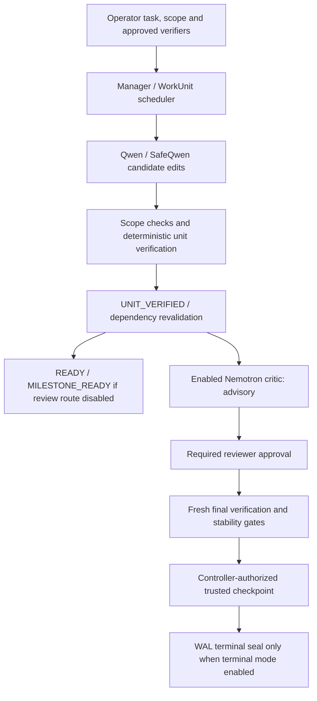

# TRIGLAV architecture

Current implementation at the [release baseline](docs/TRIGLAV_START_HERE.md):
experimental native Windows controller, x64 Python 3.11+ (supplemental CI: 3.12).
Models propose edits; deterministic evidence and controller gates authorize trust.

## Execution and trust flow

The ordinary SafeQwen CLI supplies one operator-authored fixed WorkUnit. The
opt-in two-unit API route adds dependency authorization and revalidation; historical
Live 002 demonstrated multiply -> scale. General live task decomposition and
longer SafeQwen campaigns are not established by that fixture.

The diagram branches by configured route. Neither a model's submit nor passing
unit tests alone grants checkpoint authority. Required reviews cannot waive a
failed verifier, stale evidence, scope violation or uncertain process ownership.
The complete three-model pipeline was historically verified on small fixtures;
see [qualification](docs/triglav/QUALIFICATION.md).

## Source responsibilities

| Component | Sources and responsibility |
|---|---|
| Manager and planning | manager.py, planner_protocol.py, work_unit_planner.py: lifecycle, task/check contracts, budgets and finalization |
| Units and scheduling | work_units.py, work_unit_scheduler.py: scoped plans, dependencies, attempts and revalidation |
| SafeQwen boundary | terminal_run.py, integration_shim.py, safe_executor_binding.py, safe_qwen_worker.py, tool_protocol.py: fixed-unit launch, transport/identity and closed tools |
| Deterministic verification | supervision.py, unittest_verifier.py: approved verifier execution and evidence |
| Critic/reviewer | critic.py, critic_executor.py, reviewer_executor.py, candidate_evidence.py: bounded review packets and evidence-bound decisions |
| Persistence | durable.py, environment.py: WAL, cache, environment/source identities, checkpoints and terminal records |
| Process ownership | supervision.py, winprocess.py: native Windows Job Objects, retained process identity, lifecycle and cleanup checks |
| Bounded repair | repair_evidence.py, retry_eligibility.py, safe_qwen_active_*: diagnostic evidence, eligibility, controller grants, dispatch and native verification |
| Operator/display | scripts/Invoke-Triglav.ps1, branding.py, triglav_art.py: session setup, owned gateway invocation and cosmetic stderr splash |

## Three distinct trust outcomes

1. **Intermediate:** UNIT_VERIFIED and READY / MILESTONE_READY record unit progress.
   They create no trusted checkpoint. Code-only SafeQwen normally exits 2 here.
2. **Checkpoint:** checkpoints/NNNN.json binds the candidate snapshot, applicable
   review/verification evidence and controller publication gates. It is not a
   Git commit, human signature, semantic correctness proof or terminal seal.
3. **Terminal acceptance:** separately enabled by terminal_acceptance. The terminal
   lifecycle requires fresh final verification, verified Supervisor/Gateway cleanup,
   post-cleanup candidate stability, trusted checkpoint commitment, then
   Store.commit_terminal() under the immediate publication guard. Its WAL-bound
   `acceptance/term-<run-id>.json` establishes terminal acceptance. Run status
   COMPLETED and milestone status TERMINAL_ACCEPTED are distinct fields.

Ordinary terminal_run.cli and the PowerShell wrapper do not opt into terminal
acceptance. Historical B2's checkpoint must not be described as a terminal seal.
Live 001/002 used the explicitly enabled terminal route.

## Persistence and reporting

The controller stores `runs/<run-id>/events.jsonl` as its authoritative append-only
WAL; state.json is a cache and final-report.json a projection. Review artifacts
are under milestones/, fresh final verification under final_verification/,
checkpoints under checkpoints/, and terminal seals under acceptance/ when enabled.
Legacy rounds use rounds/. Artifacts and their references must be interpreted
with the WAL, not copied into a new run as independent authority.

Publication guards validate Store revision, WAL position, candidate Git snapshot
and filesystem digest under store.mutex. Unique verifier invocation/WAL bindings
and complete review payloads prevent acceptance from stale/replayed evidence.
The candidate is intentionally dirty; stability means it matches the authorized
candidate, not that all edits disappeared.

PR #9 adds evaluate_completion/criteria_status and write_report projection of
checkpoint-backed passing final-verifier evidence. A stop label such as
ALL_CRITERIA_PROVEN alone is not proof. Historical NOT_PROVEN/completion-null
reports remain unchanged; matching cached reports can retain older projections.
See [validation history](VALIDATION.md), [durable storage](DURABLE_RUNS.md) and
[process supervision](PROCESS_SUPERVISION.md) for scoped details.

## Merged repair and remaining limits

PR #8 implements controller-owned bounded recovery through separate opt-in APIs:
first-attempt evidence/verification, diagnostic decision, single-use grant,
allocation, Attempt 2 dispatch and fresh native verification. The bound is
**two logical attempts total (one retry)**, with each worker invocation still
single-attempt. Native Attempt 2 verification stops for independent review;
it does not automatically accept the task or create a checkpoint.

The ordinary fixed-unit CLI is not that repair API. Earlier offline qualification
covers the reviewed repair scope, not real-model error-driven repair. Safe live
interruption/resume, TTL reload and campaigns beyond two SafeQwen units remain
unqualified. Proposed initial Phase 3.2 resume is restricted to verified
inter-unit boundaries; it is not restoration of in-flight inference.

SafeQwen registers only read_files, edit_file and submit. Exact paths must already
exist as regular files, remain within scope and match before_sha256 for an edit.
There is no model-facing create/delete/process/network tool. The legacy custom
executor's write_file support is a different route, not SafeQwen file creation.

Local models run sequentially through a dedicated loopback Gateway. Compatible
models can be configured through adapters/templates; the operator wrapper embeds
installation-specific paths. Optional HotPin review requires its approved expert
identity, 44 GiB available RAM admission and native 32 GiB hard working-set
readback before inference, including cached reuse. This does not bound load-time
memory or total RAM/VRAM; see [policy](docs/HOTPIN_POLICY.md).

Windows Job Objects supervise process lifetime; they are not filesystem/network
isolation. Verifiers execute trusted target code. External concurrent mutations,
hostile repositories and unattended production operation remain outside proven
scope. [CI](docs/CI.md) distinguishes the configured 390 guarded / 1,296 mandatory
qualification IDs from current-commit results.
