<p align="center">
  
</p>

<h1 align="center">TRIGLAV</h1>
<p align="center"><strong>Three Heads. One Verdict.</strong></p>
<p align="center">Local AI coding workflows with bounded edits, deterministic checks and human oversight.</p>

<p align="center">
  
  
  <a href="LICENSE"></a>
  
  <a href="https://github.com/MilJav11/triglav-harness/actions/workflows/offline-ci.yml"></a>
</p>

<p align="center">
  <a href="#overview">Overview</a> · <a href="#architecture">Architecture</a> ·
  <a href="#quick-start">Quick Start</a> · <a href="#verification">Verification</a> ·
  <a href="#safety">Safety</a> · <a href="#roadmap">Roadmap</a>
</p>

## Overview

TRIGLAV is an experimental local coding harness for native Windows, inspired by
AMAP-ML/LongHorizon-Harness: bounded work, deterministic verification, recorded
evidence and recovery/checkpoint gates. Models propose changes; the Python
controller decides whether the evidence permits acceptance.

## Architecture

The simplest path uses the included SafeQwen worker for one operator-scoped task.
It can swap compatible local models through configuration. The full multi-unit path
adds dependency scheduling, an advisory critic, an independent reviewer, fresh final verification, and durable terminal acceptance:

```mermaid
flowchart LR
    E["Qwen executor (SafeQwen)"] --> V["Deterministic verification"]
    V --> D["Dependency authorization & revalidation"]
    D --> C["Nemotron critic (advisory)"]
    C --> R["Independent GPT-OSS reviewer (HotPin)"]
    R --> F["Fresh final verifier (15/15 tests)"]
    F --> S["Supervisor & Gateway cleanup check"]
    S --> K["Validated trusted checkpoint"]
    K --> T["Durable terminal acceptance seal"]
```



Code-only execution ends at an intermediate `READY / MILESTONE_READY` result;
it does **not** create a trusted checkpoint. Model approval cannot override a
failed test, scope, ownership or checkpoint gate. The harness supports opt-in
multi-WorkUnit execution with transaction-bound terminal acceptance; see
[architecture](ARCHITECTURE.md) and [SafeQwen authority](docs/SAFEQWEN.md).

## Quick Start

Use native Windows, **x64 Python 3.11+**, Git and PowerShell. Python 3.11 is the
Windows CI baseline. The controller and guarded tests use the standard library;
no pip install, models, Gateway, OpenCode or Cline are required for offline checks.

```powershell
git clone https://github.com/MilJav11/triglav-harness.git
cd triglav-harness
python -B scripts/ci_offline.py
```

Expected: exit **0**, `PASS: 390 reviewed offline cases; CLI help; ...; model calls 0`.
The runner uses scripted responses, trusted disposable Git fixtures and real
Windows supervision; this is not a live-model test. The release changes described
here must first be committed/published: the existing remote revision does not
contain an uncommitted local working tree.

### Local Qwen calculator demo

The [public calculator fixture](examples/calculator/README.md) contains four
passing addition tests and six intentionally failing multiplication tests.
Create a **new** disposable Git target from those files; keep its tests frozen.
The [Windows demo recipe](docs/WINDOWS_SETUP.md#local-qwen-demo) gives exact
fixture creation, configurable runtime setup, dedicated Gateway/PID ownership
and shutdown steps. Separately provision compatible llama-swap, llama-server and
Qwen3-Coder-30B-A3B GGUF files; no model/runtime binary is bundled or downloaded by
this repository. No HotPin asset is needed for the basic demo.

After following that setup, from the controller root:

```powershell
python -B harness.py --config config/safeqwen.local.json autonomous-run `
  --executor safe_qwen --safeqwen-policy config/safeqwen-policy.local.json `
  --repo ../disposable-calculator --task "Implement multiply in calculator.py" `
  --verify "python -m unittest test_calculator.py" `
  --acceptance "All ten frozen tests pass; only calculator.py changes" `
  --allow calculator.py --forbid test_calculator.py --dry-run --quiet
```

Require dry-run exit **0** and `models_contacted: false`. Then run that command
**once**, removing only `--dry-run`, to invoke the local Qwen model. Successful
code-only coding normally returns exit **2**, `READY / MILESTONE_READY`, and
**10/10 tests passing**, with only `calculator.py` changed. Inspect the actual
run evidence and independently run the frozen tests. Exit 2 is not a trusted
checkpoint. Preserve failed attempts; do not silently rerun or reset the fixture.

### Optional three-model qualification

The [advanced recipe](docs/WINDOWS_SETUP.md#optional-three-model-workflow) reuses
the existing Qwen -> Nemotron -> GPT-OSS route, explicit reviewer policy and
owned-process checks. It requires separately provisioned compatible runtimes,
all GPT-OSS shards and an operator-approved expert asset/digest. Review requires
**44 GiB available RAM** and **32 GiB hard process working-set readback before
inference**, including cached-role reuse. These are not total RAM/VRAM or loading
memory guarantees. Optional HotPin work does not block the code-only demo.

## Verification

## Verification

Triglav enforces deterministic verification and multi-stage review across guarded offline CI and live executions:

### Live Milestones
- **Live Run 002 (15 October 2026):** **LIVE_002_INDEPENDENTLY_CONFIRMED**. Real local execution of two genuinely dependent WorkUnits (`multiply` -> `scale`) with real Qwen3-Coder (executor), Nemotron (advisory critic, `CRITIC_CLEAN`), and GPT-OSS 120B (senior reviewer, `APPROVE`). All **15/15 final frozen tests passed** (4 addition regression, 6 multiplication, 5 scale). Committed **213 validated WAL records** in `events.jsonl`, validated trusted checkpoint `checkpoints/0000.json`, and committed terminal acceptance seal `term-20261015T095036Z-a778f62c8873.json`. Independently confirmed by Codex review.
- **Live Run 001 (14 October 2026):** Single coding WorkUnit (`multiply`), 10/10 frozen tests passed, real three-model execution, 136 validated WAL records, terminal acceptance seal `term-20261014T091225Z-a23b9b7ed41c.json`.
- **Public Run 003 (10 October 2026):** Bounded single-unit execution with 10/10 tests and trusted checkpoint.

See the [qualification summary](docs/triglav/QUALIFICATION.md) for full records.

### Offline CI Scope
The current guarded offline CI scope is **390 reviewed cases** (`scripts/ci_offline.py`), exercising CI security guards, SafeQwen worker protocols, Supervisor lifecycle and Job Objects, durable WAL transactions and terminal seals, M0-B controller authority and publication guards, M0-C terminal lifecycle acceptance, and multi-unit dependency suites with zero live model calls. See [CI scope](docs/CI.md).

### Known Reporting Discrepancy
In legacy `final-report.json` projections, criteria are displayed as `NOT_PROVEN` with `completion: null` (only AC1 in Live Run 001; AC1..AC3 in Live Run 002) because the report derives from legacy `check_completion()` serialization. The immutable append-only Store WAL (`events.jsonl`) and cryptographic terminal seal (`acceptance/term-*.json`) establish authoritative acceptance (`status: COMPLETED`, `terminal_accepted: true`). Original evidence and report files remain unmodified.

## Safety

Use trusted repositories and frozen tests: verification executes candidate code.
Scope and process-ownership checks via Windows Job Objects are **not an OS sandbox**. Use a dedicated
loopback Gateway and keep model assets, credentials, local configurations, PID
files, logs and raw evidence outside publication. Runtime commands and model
paths are operator-configurable; templates use fictional paths.

Unverified: sustained multi-step long-horizon execution (>2 units), live error recovery/replanning, live recovery/resume during active inference, and live TTL reload. Read [setup](docs/WINDOWS_SETUP.md), [runbook](RUNBOOK.md), [recovery](CONVERGENCE.md) and [limitations](docs/triglav/SAFETY_AND_LIMITATIONS.md).

## Roadmap & Phase 3

Following the confirmed M0 milestone (`LIVE_002_INDEPENDENTLY_CONFIRMED`), the project establishes its architectural baseline for GitHub readiness before Phase 3:

1. **Phase 3.1 — Controlled Bounded Recovery:** Replanning, diagnostic error capture, and bounded retry after a failed WorkUnit without human intervention.
2. **Phase 3.2 — Safe Interruption & Resume:** Pausing active campaigns (SIGINT) and resuming cleanly from trusted checkpoints during live model operation.
3. **Documentation Backlog:** Comparative architectural analyses with AMAP-ML/LongHorizon-Harness and Utopia remain preserved in the documentation backlog.

**Note:** Phase 3 capabilities are **not yet qualified** by Live 002. See [detailed roadmap](docs/triglav/ROADMAP.md).

Eligible original software/documentation use the [MIT License](LICENSE),
copyright 2026 MilJav11; see [licensing](LICENSING.md). The independent logo has
its separate [brand usage policy](BRAND_USAGE.md) and
[artwork provenance](docs/triglav/assets/README.md).
