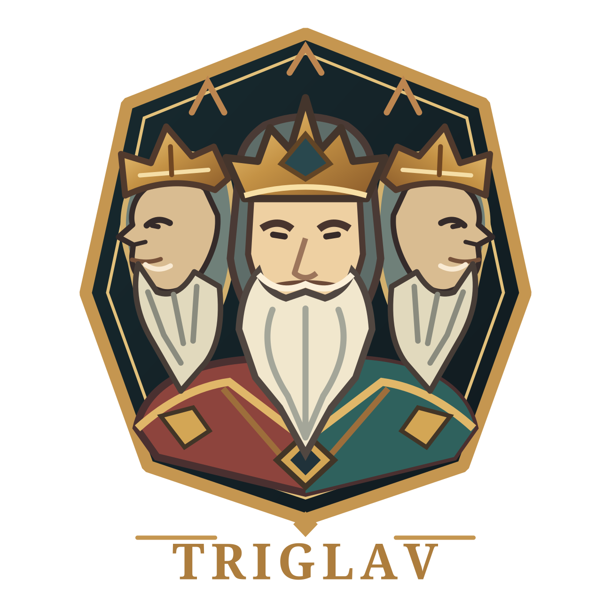

<p align="center">
  
</p>

<h1 align="center">TRIGLAV</h1>
<p align="center"><strong>Three Heads. One Verdict.</strong></p>
<p align="center">Local AI coding workflows with bounded edits, deterministic checks and human oversight.</p>

<p align="center">
  
  
  <a href="LICENSE"></a>
  
  <a href="https://github.com/MilJav11/triglav-harness/actions/workflows/offline-ci.yml"></a>
</p>

<p align="center">
  <a href="#overview">Overview</a> · <a href="#architecture">Architecture</a> ·
  <a href="#quick-start">Quick Start</a> · <a href="#verification">Verification</a> ·
  <a href="#safety">Safety</a> · <a href="#roadmap">Roadmap</a>
</p>

## Overview

TRIGLAV is an experimental local coding harness for native Windows, inspired by
AMAP-ML/LongHorizon-Harness: bounded work, deterministic verification, recorded
evidence and recovery/checkpoint gates. Models propose changes; the Python
controller decides whether the evidence permits acceptance.

Start here, then use [current release status](docs/TRIGLAV_START_HERE.md) for the
dated baseline and [operator runbook](docs/OPERATOR_RUNBOOK.md) for PowerShell.
The release checkout is `triglav-release`; its `main` baseline is `c6a90fd`
(20 October 2026). See [current GitHub CI status](docs/TRIGLAV_START_HERE.md#current-github-ci-status).

## Architecture

The simplest path uses the included SafeQwen worker for one operator-scoped task.
It can swap compatible local models through configuration. The full multi-unit path
adds dependency scheduling, an advisory critic, an independent reviewer and
fresh final verification. Terminal acceptance is a separate opt-in gate:

```mermaid
flowchart LR
    E["Qwen executor (SafeQwen)"] --> V["Deterministic verification"]
    V --> D["Dependency authorization & revalidation"]
    D --> C["Nemotron critic (advisory)"]
    C --> R["Independent GPT-OSS reviewer (HotPin)"]
    R --> F["Fresh final verifier"]
    F --> S["Supervisor & Gateway cleanup check"]
    S --> K["Validated trusted checkpoint"]
    K --> T["Terminal seal when explicitly enabled"]
```



Code-only execution ends at an intermediate `READY / MILESTONE_READY` result;
it does **not** create a trusted checkpoint. Model approval cannot override a
failed test, scope, ownership or checkpoint gate. The harness supports opt-in
multi-WorkUnit execution with transaction-bound terminal acceptance; see
[architecture](ARCHITECTURE.md) and [SafeQwen authority](docs/SAFEQWEN.md).
A checkpoint does not by itself establish terminal acceptance. The ordinary
PowerShell/CLI three-model route can create a checkpoint without a terminal seal.
SafeQwen edits **existing files only** through hash-checked anchor replacement;
it cannot create files, delete files or run model-selected shell commands.

## Quick Start

Use native Windows, **x64 Python 3.11+**, Git and PowerShell. Guarded CI uses
Python 3.11; supplemental qualification uses Python 3.12. The controller and
guarded tests use the standard library;
no pip install, models, Gateway, OpenCode or Cline are required for offline checks.

```powershell
git clone https://github.com/MilJav11/triglav-harness.git
cd triglav-harness
python -B scripts/ci_offline.py
```

Expected: exit **0**, `PASS: 390 reviewed offline cases; CLI help; ...; model calls 0`.
The runner uses scripted responses, trusted disposable Git fixtures and real
Windows supervision; this is not a live-model test.
This command runs the **390 guarded cases**. Full hosted qualification requires
**1,296 mandatory IDs** plus a separate branding/operator test step; see
[CI scope](docs/CI.md). Earlier passing results do not confirm current-commit CI.

### Local Qwen calculator demo

The [public calculator fixture](examples/calculator/README.md) contains four
passing addition tests and six intentionally failing multiplication tests.
Create a **new** disposable Git target from those files; keep its tests frozen.
The [Windows demo recipe](docs/WINDOWS_SETUP.md#local-qwen-demo) gives exact
fixture creation, configurable runtime setup, dedicated Gateway/PID ownership
and shutdown steps. Separately provision compatible llama-swap, llama-server and
Qwen3-Coder-30B-A3B GGUF files; no model/runtime binary is bundled or downloaded by
this repository. No HotPin asset is needed for the basic demo.

After following that setup, from the controller root:

```powershell
python -B harness.py --config config/safeqwen.local.json autonomous-run `
  --executor safe_qwen --safeqwen-policy config/safeqwen-policy.local.json `
  --repo ../disposable-calculator --task "Implement multiply in calculator.py" `
  --verify "python -m unittest test_calculator.py" `
  --acceptance "All ten frozen tests pass; only calculator.py changes" `
  --allow calculator.py --forbid test_calculator.py --dry-run --quiet
```

Require dry-run exit **0** and `models_contacted: false`. Then run that command
**once**, removing only `--dry-run`, to invoke the local Qwen model. Successful
code-only coding normally returns exit **2**, `READY / MILESTONE_READY`, and
**10/10 tests passing**, with only `calculator.py` changed. Inspect the actual
run evidence and independently run the frozen tests. Exit 2 is not a trusted
checkpoint. Preserve failed attempts; do not silently rerun or reset the fixture.

### Optional three-model qualification

The [advanced recipe](docs/WINDOWS_SETUP.md#optional-three-model-workflow) reuses
the existing Qwen -> Nemotron -> GPT-OSS route, explicit reviewer policy and
owned-process checks. It requires separately provisioned compatible runtimes,
all GPT-OSS shards and an operator-approved expert asset/digest. Review requires
**44 GiB available RAM** and **32 GiB hard process working-set readback before
inference**, including cached-role reuse. These are not total RAM/VRAM or loading
memory guarantees. Optional HotPin work does not block the code-only demo.

### PowerShell operator

For a guided menu, run `powershell.exe -NoProfile -File .\scripts\Start-Triglav.ps1`
from the release root. Choose a clean Git project, describe the task, select
existing editable and frozen files, and enter a deterministic verification
command. Qwen-only is the default. Every live request requires a fresh successful
DryRun and typing `RUN`; three-model mode also requires typing `THREE`.
Exit **2** with `READY / MILESTONE_READY` is a verified intermediate candidate,
not a trusted checkpoint. The menu also offers optional local profiles and
read-only persisted-run inspection. See the [launcher guide](docs/OPERATOR_RUNBOOK.md#interactive-launcher)
for result interpretation and explicit desktop shortcut installation.

The canonical wrapper is the tracked [scripts/Invoke-Triglav.ps1](scripts/Invoke-Triglav.ps1).
The [operator runbook](docs/OPERATOR_RUNBOOK.md) gives DryRun and live commands,
exit codes and evidence locations. The installed standalone copy differs;
the wrapper currently contains installation-specific runtime/session paths.
For a different installation, use the [portable setup](docs/WINDOWS_SETUP.md).

## Verification

Historical Live 002 independently confirmed the real Qwen -> Nemotron ->
GPT-OSS pipeline across two dependent units, 15/15 final frozen tests and a WAL
terminal seal. This is bounded fixture evidence, not production qualification.
See the [qualification ledger](docs/triglav/QUALIFICATION.md) and
[validation history](VALIDATION.md), including reporting caveats.

Merged PR #9 adds checkpoint-backed criteria reporting; historical
`final-report.json` discrepancies and original evidence remain unchanged.
Merged PR #10 adds the [terminal splash](docs/TERMINAL_BRANDING.md): the maintainer
visually inspected portrait, color and alignment in Windows Terminal (**PASS**).
Other terminals have no visual qualification claim.

## Safety

Use trusted repositories and frozen tests: verification executes candidate code.
Scope and process-ownership checks via Windows Job Objects are **not an OS sandbox**. Use a dedicated
loopback Gateway and keep model assets, credentials, local configurations, PID
files, logs and raw evidence outside publication. Runtime commands and model
paths in portable templates are configurable; the PowerShell wrapper embeds
installation-specific paths and an approved expert digest.

Unverified: sustained multi-step long-horizon execution (>2 units), live error
recovery/replanning, live recovery/resume during active inference, and live TTL
reload. Read [setup](docs/WINDOWS_SETUP.md), [operator guidance](docs/OPERATOR_RUNBOOK.md)
and [limitations](docs/triglav/SAFETY_AND_LIMITATIONS.md). The older
[runbook](RUNBOOK.md) and [recovery notes](CONVERGENCE.md) retain legacy-route context.

## Roadmap

Phase 3.1 bounded repair machinery is merged (PR #8): controller-owned evidence,
single-use grants and at most two logical attempts. It has earlier offline
qualification, not demonstrated live repair. Operator hardening/reporting (PR #9)
and branding (PR #10) are also merged. Safe inter-unit interruption/resume and
longer campaigns remain qualification work; see the [roadmap](docs/triglav/ROADMAP.md).

Eligible original software/documentation use the [MIT License](LICENSE),
copyright 2026 MilJav11; see [licensing](LICENSING.md). The independent logo has
its separate [brand usage policy](BRAND_USAGE.md) and
[artwork provenance](docs/triglav/assets/README.md).
