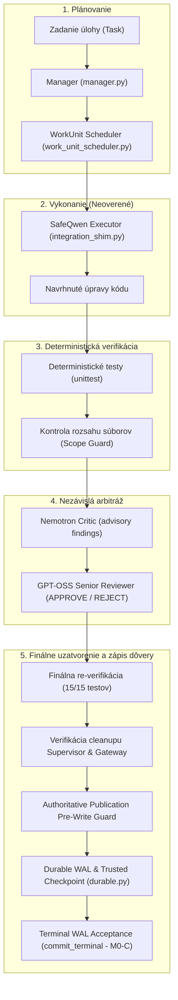

# TRIGLAV — Hlavný stavový dokument projektu (Start Here)

> **Dátum stavu:** 2026-10-14<br>
> **Účel dokumentu:** Datované odovzdávacie zhrnutie stavu projektu (*dated project handoff and status summary*).<br>
> **Technická autorita:** Tento dokument slúži na rýchlu orientáciu ľudí a AI asistentov (ChatGPT, Codex, Gemini, Claude). Skutočnou technickou autoritou však vždy zostáva reálny Git zdrojový kód, deterministické testy a perzistované dôkazy v úložisku (*persisted evidence*).

---

### Rýchly prehľad stavu (Status Summary)

| Stav | Popis |
|---|---|
| **M0-A — SCHVÁLENÉ A COMMITNUTÉ** | **Commit:** `590e16e4b83296050c943db7a273c2cef71c584a`<br>Primitív terminálnej akceptácie v `durable.py` nezávisle schválený recenzentom Codex a lokálne commitnutý. Izolovaná kvalifikácia: **309/309 strážených offline testov**. |
| **M0-B — SCHVÁLENÉ A COMMITNUTÉ** | **Commit:** `eca6cf816c32e38c43042b433068207b1b9f6cdf` (Parent: `590e16e4...`)<br>Integrovaná kontrolérska autorita, proveniencia exekúcie, viazanie schválenej verifikačnej politiky, WAL attempt identity, perzistované schválenie reviewerom, stráže checkpoint publikácie a striktná validácia prechodov heartbeatov. Nezávislé posúdenie Codex: **M0B_REVIEW_PASS**. Kvalifikácia: **352/352 strážených offline testov**, **83/83 durable testov**, 0 volaní živých modelov. |
| **M0-C — SCHVÁLENÉ A COMMITNUTÉ** | **Commit:** `236d08fa3b3ca771f1f7d2b6654348a298a28a98` (Parent: `c81b5476...`)<br>Plná integrácia terminálneho životného cyklu akceptácie: prepojenie finalizácie s overeným cleanupom Supervisor a Gateway, zápis `Store.commit_terminal()` do WAL, perzistencia a zotavenie checkpointov, idempotentné terminálne hlásenie, podpora WorkUnit vstupných bodov (`execute_work_units`, `plan_and_execute_work_units`), striktná proveniencia reuse checkpointov a atomické určenie attempt-end revízie. Nezávislé posúdenie Codex: **M0C_REVIEW_PASS**. Kvalifikácia: **373/373 strážených offline testov**, 0 volaní živých modelov. |
| **LIVE RUN 001 — DOKONČENÉ** | **Dátum:** 2026-10-14, Run ID: `20261014T091225Z-a23b9b7ed41c`<br>Jedna reálna kódovacia WorkUnit (`multiply`), reálne modely Qwen, Nemotron a GPT-OSS, 10/10 testov prešlo, 136 autoritatívnych WAL záznamov, terminálna pečať `term-20261014T091225Z-a23b9b7ed41c.json`. |
| **LIVE RUN 002 — SCHVÁLENÉ** | **Commit:** `92cd9e03148f4dd5fbe3bb532601c0a9d3f5d80d`<br>**Míľnik:** `LIVE_002_INDEPENDENTLY_CONFIRMED` (2026-10-15), Run ID: `20261015T095036Z-a778f62c8873`. Dve závislé WorkUnits (`multiply` -> `scale`), reálna inferencia Qwen, Nemotron a GPT-OSS HotPin, **15/15 testov prešlo**, **213 validovaných WAL záznamov**, terminálna pečať `term-20261015T095036Z-a778f62c8873.json`, trusted checkpoint `checkpoints/0000.json`. Nezávisle potvrdené recenzentom Codex. |
| **POZASTAVENÉ / LIMITÁCIE** | Živé ohraničené zotavenie po zlyhaní WorkUnit (*bounded recovery*) a bezpečné prerušenie a pokračovanie (*safe interruption/resume*) počas živej inferencie ostávajú nekvalifikované v živej prevádzke. Celkové offline CI pokrýva **390/390 testov**. |
| **NAJBLIŽŠÍ KROK** | Fáza 3: Ohraničené zotavenie po zlyhaní jednotky (*bounded recovery*), následne bezpečné prerušenie a resume. Predtým: revízia M0 dokumentácie a príprava GitHub publikácie. |

---

## 1. Čo je TRIGLAV? (What is TRIGLAV?)

**TRIGLAV** je autonómny systém na lokálny vývoj softvéru pomocou umelej inteligencie (*local-first autonomous AI coding harness*), navrhnutý pre operačný systém Windows. Projekt je inšpirovaný architektúrou `AMAP-ML/LongHorizon-Harness`.

### Základná filozofia
- **Lokálne modely:** Beží na lokálnom hardvéri s modelmi obsluhovanými cez `llama-server` / `llama-swap` bez závislosti na externých cloudových API.
- **Modely nie sú autoritou:** Žiadny model (ani Qwen, Nemotron či GPT-OSS) nie je považovaný za nositeľa pravdy (*ground truth*). Modely iba **navrhujú** zmeny kódu.
- **Deterministické riadenie:** O tom, či je zmena prijatá, rozhoduje výhradne deterministický kontrolér napísaný v Pythone na základe vopred pripravených, zamrznutých testov (*frozen tests*), kontroly rozsahu povolených súborov (*scope containment*) a nezávislých validačných brán.
- **Garantovaná integrita:** Dôveryhodný stav (*trusted checkpoint*) sa zapíše do trvalého logu (*durable WAL*) iba vtedy, ak prebehnú všetky verifikačné kroky, nezávislý review, kontrola integrity a preukázateľný cleanup procesov. Žiadne TOCTOU obchádzanie brán nie je povolené.

---

## 2. Umiestnenie projektu a pracovné prostredie (Project Locations)

Pre správne pochopenie stavu projektu je nevyhnutné rozlišovať medzi hlavným Git repozitárom, aktívnym pracovným stromom a historickými zálohami:

| Položka | Cesta / Identifikátor | Popis |
|---|---|---|
| **Hlavný Git repozitár** | `<repo-root>` (`triglav-harness-public`) | Primárny Git repozitár projektu s plnou históriou a vetvami. |
| **Aktívny Git worktree** | `<worktree-root>` (`triglav-live-002`) | **Aktuálne primárne pracovné prostredie.** Obsahuje schválené míľniky M0-A, M0-B, M0-C a Live Run 002. |
| **Aktívna vetva (Branch)** | `feat/live-002-qualification` | Pracovná vetva pre kvalifikáciu dvoch závislých WorkUnits (Live 002). |
| **Aktuálny HEAD** | `92cd9e03148f4dd5fbe3bb532601c0a9d3f5d80d` | Schválený kvalifikačný commit: *"feat: enable WAL-bound SafeQwen two-unit execution"*. |
| **Starší chránený worktree** | `<worktree-root>/triglav-manager-ci` | **Uchovávať nedotknuté!** Obsahuje 5 historických chránených necommitnutých zmien na vetve `feat/phase3b2-live-bridge`. |
| **Overená záloha (Backup)** | `<backup-dir>/m0_candidate_20261012_182321` | **Uchovávať nedotknuté!** Externá overená záloha obsahujúca pôvodný kandidátsky patch M0 a kontrolné súčty SHA-256. |

---

## 3. Aktuálna architektúra (As-Is Architecture)

Architektúra systému TRIGLAV je postavená na prísnom oddelení právomocí jednotlivých komponentov:



### Prehľad komponentov:

1. **Manager (`manager.py`, `ManagerLoop`):**
   - Riadi celkový životný cyklus behu: prechody stavov (`READY` -> `PLANNING` -> `EXECUTING` -> `VERIFYING` -> `CRITIQUING` -> `REVIEWING` -> `CHECKPOINTING` -> `VERIFIED`).
   - Vynucuje kontrolérsku autoritu pri overovaní pripravenosti na akceptáciu.

2. **WorkUnit Planner & Scheduler (`work_units.py`, `work_unit_planner.py`, `work_unit_scheduler.py`):**
   - Rozdeľuje úlohu na atomické pracovné jednotky (*WorkUnits*).
   - Každá jednotka má striktne definovaný rozsah povolených ciest (`allowed_paths`) a zakázaných ciest (`forbidden_paths`).

3. **SafeQwen Executor & Worker (`integration_shim.py`, `safe_qwen_worker.py`):**
   - `SafeQwenExecutor` (v `integration_shim.py`) integruje transport cez Gateway a riadi komunikáciu; `SafeQwenWorker` (v `safe_qwen_worker.py`) riadi dialógovú históriu a vykonáva operácie podľa uzavretého protokolu 3 nástrojov (`read_files`, `edit_file`, `submit`) s politikou jedného pokusu (*one-attempt policy*). Generuje navrhované zmeny v kóde; nemá právomoc schvaľovať.

4. **Deterministická verifikácia (`supervision.py`, `unittest`):**
   - Spúšťa nemenné testy v dispozičnom repozitári. Každá exekúcia má unikátny, autoritatívny záznam vo WAL s 1-to-1 mapovaním.

5. **Nemotron Critic (`critic.py`, `critic_executor.py`):**
   - Poradná rola (*advisory critic*). Hodnotí kód a verifikačné dôkazy (`CRITIC_CLEAN` alebo `CRITIC_FINDINGS`).

6. **GPT-OSS Senior Reviewer (`reviewer_executor.py`, `candidate_evidence.py`):**
   - Nezávislý arbiter. Vyžaduje sa rozhodnutie `APPROVE`, ktorého kompletný ne-nulový payload je kryptograficky viazaný na WAL záznam schválenia.

7. **Gateway & Model Lifecycle (`harness.py:Gateway`):**
   - Spravuje načítanie modelov do pamäte a povinné uvoľnenie z pamäte (`unload`).

8. **Supervisor (`supervision.py`, `supervision_worker.py`, `winprocess.py`):**
   - Dohliada na procesy na úrovni Windows OS (PID, identita, containment). Heartbeaty podliehajú striktnej kontrole hodnôt (zákaz mutácie PID, executable, containment, state).

9. **Durable WAL, Checkpoints & Store (`durable.py`, `environment.py`):**
   - Zabezpečuje trvalý transakčný log (*Write-Ahead Log*).
   - Vynucuje pre-write guardy overujúce Store revíziu, dĺžku WAL, snapshot repozitára a kanonický digest súborového systému.
   - Poskytuje presné potvrdenky (`commit` / `append_record` receipts) odolné voči prekrývaniu pri projekcii cache.

---

## 4. Čo skutočne funguje? (What Really Works?)

| Kategória | Funkcionalita / Komponent | Podrobnosti a stav |
|---|---|---|
| **IMPLEMENTED & COMMITTED** | M0-A (Terminal WAL primitive), M0-B (Controller authority, provenance, 1-to-1 verifiers, publication guard, heartbeat validation), M0-C (Terminal lifecycle acceptance, Supervisor/Gateway cleanup verification, checkpoint preservation, idempotent reporting, WorkUnit entry points) a Live 002 opt-in multi-unit integrácia. | Commitnuté v `590e16e4...`, `eca6cf81...`, `236d08fa...` a `92cd9e03148f4dd5fbe3bb532601c0a9d3f5d80d` na vetve `feat/live-002-qualification`. |
| **OFFLINE VERIFIED** | **390 strážených offline CI testov** (`scripts/ci_offline.py`) a **83 testov odolnosti** (`test_durable.py`). | 100 % úspešnosť (exit kód 0), 0 volaní živých modelov. Pokrýva determinizmus, timeouty, procesnú izoláciu, crash recovery, autoritatívne testy M0-B, regresné testy M0-C a multi-unit produkčné testy. |
| **LIVE QUALIFIED** | **Live Run 001 & Live Run 002** | Reálne lokálne trio modelov (Qwen3-Coder, Nemotron-3.5-Lightning, GPT-OSS 120B HotPin) úspešne dokončilo: 1) ohraničenú 1-jednotkovú úlohu (Live 001: 10/10 testov, 136 WAL záznamov, terminálna pečať); 2) dve závislé jednotky (Live 002: 15/15 testov, 213 validovaných WAL záznamov, terminálna pečať, nezávisle potvrdené recenzentom Codex). |
| **HISTORICAL PREVIEW** | **Public Run 003 (10. október 2026)** | Historický ohraničený test s 10/10 testami a trusted checkpointom. |
| **NOT YET LIVE VERIFIED** | Viac-kroková dlhodobá autonómia (>2 WorkUnits); Živé zotavenie po zlyhaní jednotky (*bounded recovery*); Bezpečné prerušenie a pokračovanie počas živej inferencie (*mid-inference live recovery/resume*); Dynamický TTL reload modelov. | Plánované pre Fázu 3; nebolo zatiaľ kvalifikované v živom behu. |

---

## 5. Aktuálny verifikovaný stav (Current Verified State)

### Dokončené míľniky:

1. **M0-A (Terminal Acceptance Primitive):**
   - **Commit:** `590e16e4b83296050c943db7a273c2cef71c584a`
   - Nezávisle schválený recenzentom Codex.
   - Poskytuje striktnú, jednocestnú terminálnu pečať transakcie vo WAL (`commit_terminal`), ochranu pred sirotami (*orphan seals*) a odolnosť voči pádom.
   - Kvalifikácia: 309/309 strážených offline testov.

2. **M0-B (Transaction Authority & Publication Guards):**
   - **Commit:** `eca6cf816c32e38c43042b433068207b1b9f6cdf` (Parent: `590e16e4...`)
   - Nezávisle schválený recenzentom Codex: verdikt **M0B_REVIEW_PASS**.
   - **Vyriešených 6 pôvodných defektov + 2 dodatočné korekcie:**
     - *P0 Publication Bypass:* `create_trusted_checkpoint()` nezávisle vynucuje validáciu pripravenosti pod zámkom `store.mutex` a pre-write guardom pred publikáciou.
     - *P1 Immutable Attempt Completion:* Kotvenie revízie a identity pokusu na nemenný WAL záznam `final_verification_attempt_ended`.
     - *P1 One-to-One Verifiers:* Striktné 1-to-1 mapovanie verifikátorov na unikátne WAL sekvencie (zákaz duplicitného [29, 29]).
     - *P1 Approval Payload:* Vyžadovaný kompletný, ne-nulový autoritatívny payload schválenia viazaný na WAL záznam.
     - *P1 Heartbeat & WAL Coverage:* Kontrola každého WAL záznamu po hranici pokusu; striktné porovnanie hodnôt (zákaz zmeny PID, executable, identity, state, containment).
     - *P1 Exact Commit Receipts:* Zachytenie presného záznamu transakcie pred projekciou stavu (`atomic_write`), odolné voči útokom s vkladaním záznamov.
     - *Fix 1 Source Consistency:* Pre-write guard sníma kompletný snapshot repozitára a prepočítava kanonický digest súborového systému (nespolieha sa len na Git HEAD).
     - *Fix 2 Heartbeat Transitions:* Striktné porovnávanie predchádzajúceho a nového stavu supervision podľa reálnej schémy `Supervisor.heartbeat()`.
   - Kvalifikácia: **352/352 strážených offline testov**, **83/83 durable testov**, 0 volaní modelov.

3. **M0-C (Terminal Lifecycle Acceptance & WorkUnit Finalization):**
   - **Commit:** `236d08fa3b3ca771f1f7d2b6654348a298a28a98` (Parent: `c81b5476d8185d9eff9d6180cf05101c2052ce77`)
   - Nezávisle schválený recenzentom Codex: verdikt **M0C_REVIEW_PASS**.
   - Plná kvalifikácia: **373/373 strážených offline testov** (`scripts/ci_offline.py`), 0 volaní živých modelov.
   - **Integrovaný životný cyklus terminálnej akceptácie:**
     - Prepojenie dokončenia WorkUnit -> deterministická verifikácia -> schválenie senior reviewerom -> verifikácia cleanupu Supervisor a Gateway -> kontrola repozitára po cleanupe -> `Store.commit_terminal()` autoritatívny zápis do WAL -> trvalé znovunačítanie stavu.
     - Podpora priamych vstupných bodov: `execute_work_units()` aj `plan_and_execute_work_units()` plne rešpektujú `terminal_acceptance=True` a smerujú cez rovnaký validovaný terminálny životný cyklus bez tichého návratu `MILESTONE_READY`.
     - Idempotentné terminálne hlásenie: volanie `execute()` na už terminálne akceptovanom behu vráti akceptovaný výsledok bez štartu Supervisora alebo nových Store commitov.
   - **Kľúčové vyriešené defekty a overené správanie:**
     - *Checkpoint History & Safe Reuse:* Prerušenie finalizácie a následné resume neprepíšu existujúci checkpoint artefakt iným obsahom. Pôvodné referencie a hashe ostávajú zachované; opätovné použitie je povolené len pre autentický, identický a overený checkpoint.
     - *Durable Terminal Mode Persistence:* Explicitné nastavenie `terminal_acceptance=True` prežíva prerušenie a resume; efektívny mód sa bez nového overrideu odvodzuje z trvalej konfigurácie behu.
     - *Strict Checkpoint Reuse Provenance:* Zákaz nepovolenej skratky reuse; autentifikácia kontroléra pred kontrolou reuse; overenie, že cesta, ID, referencia a digest presne zodpovedajú autoritatívnej schválenej publikácii; odmietnutie skopírovaných, substituovaných alebo sfalšovaných referencií bez mutácie Store.
     - *Atomic Attempt-End Revision Determination:* Atomické určenie revízie po ukončení pokusu pod zámkom `store.mutex` pred povolením heartbeatov Supervisora, čím sa zabránilo race condition a falošným zlyhaniam revízie.

---

## 6. Dôležité obmedzenia (Important Limitations)

1. **Offline úspech nedokazuje živú inferenciu:** Úspech offline CI (390 testov) overuje deterministické riadenie a ochranu integrity kontroléra, nie správanie živých modelov. Živé modely podliehajú samostatnej kvalifikácii.
2. **Opt-in terminálna akceptácia:** Terminálna akceptácia je voliteľná (`terminal_acceptance=True`) a zachováva predvolené správanie pre legacy workflow.
3. **Okno externej mutácie:** Zámok `store.mutex` synchronizuje interné operácie v Pythone, ale izolácia súborového systému pred externými procesmi mimo Store nie je absolútna. Pre-write guard minimalizuje toto okno na najmenšiu možnú teoretickú hranicu bezprostredne pred zápisom do WAL.
4. **Ohraničená živá kvalifikácia:** Trio lokálnych modelov (Qwen, Nemotron, GPT-OSS) bolo úspešne kvalifikované na ohraničených úlohách jednej a dvoch závislých WorkUnits (Live 001 a Live 002). Viac-kroková dlhodobá prevádzka (>2 jednotky) zostáva neoverená.
5. **Neoverené viac-WorkUnit živé zotavenie:** Automatické zotavenie po zlyhaní jednotky (*bounded error recovery*) a bezpečné prerušenie/resume počas živej inferencie ostávajú nekvalifikované v živej prevádzke (predmet Fázy 3).
6. **Odložená optimalizácia:** HotPin 120B zostáva odloženou voliteľnou optimalizáciou a nesmie blokovať jadro systému.

---

## 7. Architektonické rozhodnutia (Architectural Decisions)

V projekte platí záväzné rozhodnutie **Strategy B**:
- **Zachovať existujúce jadro:** Ponechávame existujúci Triglav Manager, WorkUnit scheduler, SafeQwen executor, Durable WAL a deterministickú verifikáciu.
- **Žiadny prepis orchesteru:** Nebudeme zahadzovať existujúci kód ani nahrádzať architektúru celým balíkom LongHorizon. AMAP-ML/LongHorizon-Harness slúži výhradne ako inšpirácia pre prísne kontrakty a zotavenie.
- **Najmenšia funkčná zmena:** Preferujú sa minimálne zmeny riešiace konkrétne zlyhanie.
- **Žiadne obchádzanie brán:** Nikdy sa nesmú oslabovať požiadavky na verifikáciu, kontrolu rozsahu súborov ani schválenie reviewerom.

---

## 8. Nasledujúci inžiniersky krok (Next Engineering Step)

Po úspešnej kvalifikácii míľnikov Live Run 001 (1 WorkUnit) a Live Run 002 (2 závislé WorkUnits, `LIVE_002_INDEPENDENTLY_CONFIRMED`) a príprave GitHub publikácie je ďalším cieľom Fáza 3:

1. **Fáza 3.1 — Kontrolované ohraničené zotavenie (*bounded recovery*):**
   - Diagnostický zber chýb verifikátora, ohraničený rozpočet pokusov a oprava zlyhanej WorkUnit modelom SafeQwen bez manuálneho zásahu.
2. **Fáza 3.2 — Bezpečné prerušenie a spoľahlivé pokračovanie (*safe interruption & resume*):**
   - Možnosť bezpečne prerušiť (SIGINT) bežiacu kampaň a spoľahlivo pokračovať z overeného checkpointu počas živej inferencie.

---

## 9. Ako pokračovať v novom chate (How to Resume in a New Chat)

Každý inžinier alebo AI asistent (ChatGPT, Codex, Gemini, Claude), ktorý začína novú reláciu, **MUSÍ** postupovať podľa tohto kontrolného zoznamu:

1. **Prečítať tento dokument:** `docs/TRIGLAV_START_HERE.md` a súbor pravidiel `AGENTS.md`.
2. **Overiť stav Git repozitára v aktívnom worktree:**
   ```powershell
   cd <worktree-root> # napr. triglav-live-002
   git status --short --branch
   git rev-parse HEAD
   ```
   *Očakávaný stav:* Vetva `feat/live-002-qualification`, HEAD `92cd9e03148f4dd5fbe3bb532601c0a9d3f5d80d` (alebo následný dokumentačný commit), čistý pracovný strom.
3. **Uistiť sa o ochrane staršieho worktree a zálohy:**
   - Referenčný worktree `triglav-manager-ci` (uchovávať nedotknuté!)
   - Externá overená záloha `m0_candidate_20261012_182321` (uchovávať nedotknuté!)
4. **Overiť testovacie sady:**
   ```powershell
   python -B -m unittest discover -s tests -p "test_durable.py"
   python -B scripts/ci_offline.py
   ```
   *Očakávaný výsledok:* Exit kód 0, 83 durable testov a 390 offline CI prípadov prešlo.
5. **Zásada obozretnosti:** Nikdy nepredpokladať, že úspech v offline testoch znamená, že kód funguje so živými modelmi.
6. **Počkať na autorizáciu:** Začať živú kvalifikáciu až po výslovnom zadaní od manažéra (ChatGPT).

---

## 10. Bezpečnostné a prevádzkové pravidlá (Safety & Operation Rules)

1. **Nezahadzovať prácu:** Nikdy nespúšťať `git reset --hard`, `git checkout .` ani `git clean` bez výslovného príkazu a overenej zálohy.
2. **Žiadne samovoľné commity:** Nikdy necommitovať, nepushovať ani nevytvárať Pull Requesty bez autorizácie.
3. **Zákaz neschváleného spúšťania modelov:** Nespúšťať živé modely ani Gateway, pokiaľ to úloha vyslovene nevyžaduje a nie sú splnené bezpečnostné brány.
4. **Nemeniť piny:** Nikdy v tichosti nemeniť verzie knižníc, hashe zdrojových súborov ani systémové požiadavky.
5. **Zachovávať históriu:** Nikdy neprepísať ani nezmazať predchádzajúce akceptované checkpointy.
6. **Oddelenie rolí:** Implementačný inžinier (Gemini) nehodnotí vlastnú prácu. Nezávislé posúdenie vykonáva Reviewer (Codex) a celkový proces riadi Manager (ChatGPT).
7. **Okamžité zastavenie pri zlyhaní:** Ak príkaz zlyhá alebo narazí na architektúrny blokátor, agent musí okamžite zastaviť prácu a nahlásiť zlyhanie.

---

## 11. Posledný verifikovaný stav (Last Verified Status)

- **Dátum overenia:** 2026-10-15
- **Priamo overené fakty v tomto prostredí:**
  - Aktívny pracovný strom: `triglav-live-002` na vetve `feat/live-002-qualification`.
  - M0-A Commit: `590e16e4b83296050c943db7a273c2cef71c584a`.
  - M0-B Commit: `eca6cf816c32e38c43042b433068207b1b9f6cdf`.
  - M0-C Commit: `236d08fa3b3ca771f1f7d2b6654348a298a28a98`.
  - M0-Live-002 Commit: `92cd9e03148f4dd5fbe3bb532601c0a9d3f5d80d`.
  - Autoritatívny míľnik: `LIVE_002_INDEPENDENTLY_CONFIRMED`.
  - Úspešný beh dvoch závislých WorkUnits: Run ID `20261015T095036Z-a778f62c8873`, 15/15 finálnych testov prešlo, 213 validovaných WAL záznamov, terminálna pečať `term-20261015T095036Z-a778f62c8873.json`.
  - Predchádzajúci živý beh: Live Run 001 (`20261014T091225Z-a23b9b7ed41c`), jedna WorkUnit, 10/10 testov prešlo, 136 WAL záznamov, terminálna akceptácia.
  - Úspešný beh offline CI: **390/390 testov prešlo** (`scripts/ci_offline.py`), 0 model calls.
  - Všetky pôvodné dôkazy, WAL a checkpointy zachované bez prepisovania.
- **Zdedené informácie z predchádzajúcich správ:**
  - Výsledky Public Run 003 z 10. októbra 2026.
  - Hardvérové limity pre HotPin 120B (44 GiB RAM gate, 32 GiB working-set readback).
