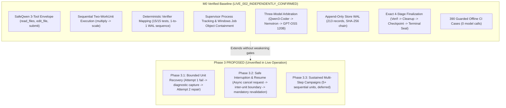
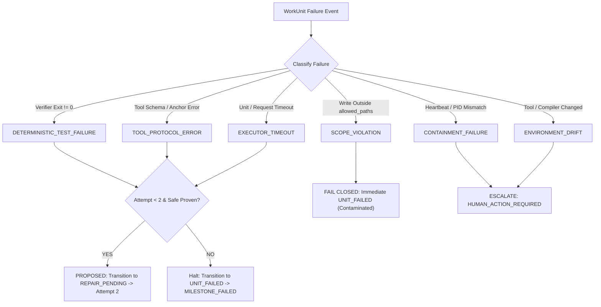
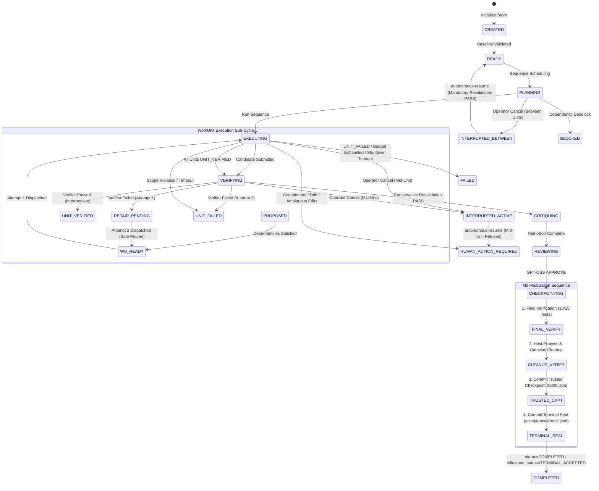
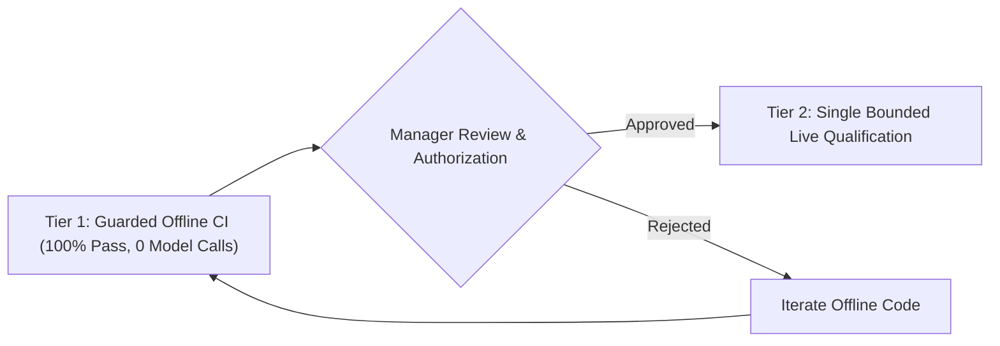

# TRIGLAV Phase 3 — Architecture Design

> **Document Type:** Technical Architecture Specification<br>
> **Status:** PROPOSED Architecture Design (Not Implemented / Not Live Qualified)<br>
> **Platform Baseline:** Native Windows (x64 Python 3.11+ / 3.12)<br>
> **Current Reference Milestone:** `LIVE_002_INDEPENDENTLY_CONFIRMED` (`92cd9e03148f4dd5fbe3bb532601c0a9d3f5d80d`)<br>
> **Target Milestones:** Phase 3.1 (Bounded Unit Recovery) & Phase 3.2 (Safe Interrupt & Resume)

---

## 1. Purpose and Non-Goals

### 1.1 Purpose
In autonomous coding harnesses operating on native Windows, long-horizon resilience requires handling two inevitable real-world failure classes without compromising controller authority:
1. **Defective candidate code generation:** Local models frequently introduce subtle syntax errors, inverted logic, or off-by-one boundary bugs on an initial attempt. Terminating an entire multi-unit campaign upon the first test failure wastes compute, memory bandwidth, and thermal headroom. Controlled, bounded recovery allows the harness to supply deterministic test failure evidence to the model for a bounded second attempt.
2. **Operational and execution interruptions:** Long campaigns are subject to operator interruptions (e.g., SIGINT/Ctrl+C), host maintenance, or environmental delays. Without safe, transactional interruption and resume, an interrupted campaign leaves unverified working-tree state, ambiguous child process ownership, and orphaned Write-Ahead Log (WAL) records.

Phase 3 establishes rigorous, fail-closed controller mechanisms for bounded WorkUnit retry and transactional pause/resume while preserving the fundamental TRIGLAV invariant: **models propose, but only deterministic verifiers and controller transaction gates authorize trusted progress.**

### 1.2 Non-Goals
To prevent scope creep and maintain architectural integrity, the following are explicitly excluded:
- **Production Readiness:** TRIGLAV remains an experimental research harness for native Windows; enterprise distribution, multi-tenant isolation, and arbitrary host execution are out of scope.
- **Unbounded Autonomy:** No open-ended retry loops, unbudgeted repair attempts, or self-directed task replanning. All execution is strictly bounded by attempt counts, round budgets, and hard wall-clock timeouts.
- **Resumption Within Active WorkUnits Excluded:** For initial Phase 3.2 qualification, automatic resume is strictly restricted to verified boundaries BETWEEN WorkUnits. Resumption within an active or partially executed WorkUnit, or merely between tool actions, is explicitly excluded; active unit interruptions fail closed.
- **Mid-Inference Token-Stream Restoration:** The harness will **not** snapshot model KV-caches or attempt to resume an interrupted model inference call mid-generation.
- **Automatic Reset or Rollback of Ambiguous Edits:** The harness will **never** perform blind `git reset --hard` or automatic deletion of candidate edits when state is ambiguous. Unverified side effects fail closed for operator audit.
- **Silent WAL Repair:** The harness will **never** silently repair a corrupt authoritative Write-Ahead Log or broken SHA-256 chain. Uncertain persistence fails closed immediately.
- **Operating System Sandboxing:** Windows Job Objects supervise child process lifetime and prevent orphan trees, but do not provide kernel-level filesystem virtualization or network isolation.
- **Model-Authorized Waivers:** No model verdict (critic or reviewer) can waive a failed deterministic verification test, bypass scope checks, or override process ownership rules.

---

## 2. Verified M0 Baseline

The Phase 3 design builds strictly on the verified M0 baseline. All prior verified capabilities are separated from proposed Phase 3 behavior:



### 2.1 Live Run 001 Summary
- **Date & Run ID:** 14 October 2026, `20261014T091225Z-a23b9b7ed41c`.
- **Baseline Commit:** `236d08fa3b3ca771f1f7d2b6654348a298a28a98` / `b7e1269f1229cf557c7912746d3089be00dc0243`.
- **Scope & Verification:** Single coding WorkUnit (`multiply` in `calculator.py`), 10/10 frozen unit tests passed.
- **Arbitration & Durability:** Real Qwen3-Coder, Nemotron critic, GPT-OSS 120B reviewer (`APPROVE`). 136 validated WAL records in `events.jsonl`, trusted checkpoint `checkpoints/0000.json`, cryptographic terminal seal `acceptance/term-20261014T091225Z-a23b9b7ed41c.json`. State: `COMPLETED`, `milestone_status: TERMINAL_ACCEPTED`.

### 2.2 Live Run 002 Summary
- **Date & Run ID:** 15 October 2026, `20261015T095036Z-a778f62c8873`.
- **Authoritative Commit:** `92cd9e03148f4dd5fbe3bb532601c0a9d3f5d80d`.
- **Scope & Verification:** Two genuinely dependent WorkUnits (`multiply` -> `scale`), intermediate verifications (`UNIT_VERIFIED`), and fresh final verification passing **15/15 frozen tests** across three test classes (`ExistingAdditionTests`, `RequiredMultiplicationTests`, `RequiredScaleTests`).
- **Arbitration & Durability:** Real three-model sequence (Qwen -> Nemotron `CRITIC_CLEAN` -> GPT-OSS 120B `APPROVE`). 213 validated WAL records in `events.jsonl`. Pre-write publication guard validated Store revision 150, scoped repository snapshot digest, and filesystem digest. Validated trusted checkpoint `checkpoints/0000.json`. Cryptographic terminal seal `acceptance/term-20261015T095036Z-a778f62c8873.json` committed. Independently confirmed by Codex.
- **Reporting Discrepancy Note:** Both live runs retain the known legacy `final-report.json` projection discrepancy where criteria display as `NOT_PROVEN` (`completion: null`) due to legacy `check_completion()` serialization. The authoritative append-only Store WAL (`events.jsonl`) and terminal seal establish verified acceptance.

---

## 3. AS-IS Architecture

The production implementation partitions responsibilities across distinct modules:

| Subsystem | Source Files | Operational Responsibilities | Authority Level |
|---|---|---|---|
| **Manager & Loop** | `manager.py`, `planner_protocol.py` | Top-level state machine (`READY` to `COMPLETED`), deadline enforcement, budget tracking (`resolve_budgets`), and terminal finalization (`finalize_terminal_acceptance`). Preserves distinction between run `status: COMPLETED` and milestone `status: TERMINAL_ACCEPTED`. | Controller Authority |
| **WorkUnit Scheduler** | `work_unit_scheduler.py`, `work_units.py` | Sequential WorkUnit DAG scheduling, dependency checking (`evaluate_readiness`), conservative milestone revalidation (`revalidate_milestone`), and intermediate unit state sealing (`seal_unit_state`). | Controller Authority |
| **SafeQwen Executor** | `integration_shim.py`, `terminal_run.py`, `safe_executor_binding.py` | Adapts Gateway HTTP transport, enforces request deadlines, emits action/request audit artifacts, and validates pinned SafeQwen policy contracts. | Untrusted Adapter |
| **SafeQwen Worker** | `safe_qwen_worker.py`, `tool_protocol.py` | Manages closed 3-tool contract (`read_files`, `edit_file`, `submit`), exact hash-verified file replacement, action limits (max 32), and payload boundaries. | Untrusted Worker |
| **Deterministic Verifier** | `supervision.py`, `unittest` | Executes allowlisted test commands in target repository under supervised Windows Job Objects; maps each execution 1-to-1 to a WAL sequence. | Deterministic Oracle |
| **Process Supervisor** | `supervision.py`, `winprocess.py` | Native Windows Job Object tracking (`Local\harness-<token>`), background heartbeat thread, child lifecycle tracking (`STARTING`, `RUNNING`, `STOPPING`, `EXITED`, `LOST`, `STALE`, `UNKNOWN`, `RESOLVED`), and fail-closed process reconciliation. | Operating System Broker |
| **Durable Store / WAL** | `durable.py`, `environment.py` | Append-only ledger (`events.jsonl`), pre-write publication guards, atomic `state.json` updates, exclusive file locking (`msvcrt.locking`), and repository Git snapshots. | Authoritative Persistence |
| **Arbitration Chain** | `critic_executor.py`, `reviewer_executor.py`, `candidate_evidence.py` | Advisory Nemotron critique (`CRITIC_CLEAN` / `CRITIC_FINDINGS`), senior GPT-OSS 120B review (`APPROVE`), candidate diff evidence binding, and trusted checkpoint creation. | Senior Arbiter |

### 3.1 Intermediate UNIT_VERIFIED vs. Trusted Terminal Checkpoint
A critical invariant of the M0 architecture is the strict boundary between intermediate unit progress and trusted checkpoints:
- **`UNIT_VERIFIED` is an intermediate, uncheckpointed unit state.** It establishes only that a specific WorkUnit's local deterministic verifiers passed against candidate code. It does **not** update top-level `verified_progress`, does **not** update `last_verified_checkpoint`, does **not** write a checkpoint artifact to disk, and does **not** establish terminal acceptance.
- **A Trusted Checkpoint (`checkpoints/NNNN.json`)** requires completion of all units, full three-model arbitration (or explicit policy exemption), and fresh final deterministic verification across all suites.
- **A Terminal Acceptance Seal (`acceptance/term-<run_id>.json`)** requires verified process and gateway cleanup, post-cleanup repository stability recheck, trusted checkpoint commitment, and an immediate pre-write publication guard under `store.mutex`.

### 3.2 Exact M0 Finalization Order
In `manager.py:finalize_terminal_acceptance`, the controller enforces an unalterable 4-stage lifecycle sequence:
1. **Stage 1 — Fresh Final Deterministic Verification:** Execute the complete frozen verification suite (e.g., 15/15 tests) after model reviewer approval (`APPROVE`).
2. **Stage 2 — Mandatory Host Process & Gateway Cleanup Verification:**
   - Gateway model unloaded (`gateway.unload()`); Gateway verified empty.
   - Supervisor shut down (`supervisor.shutdown()`); heartbeat thread terminated; child process list confirmed idle.
   - Post-cleanup candidate stability recheck: verify candidate Git HEAD, candidate snapshot digest, and filesystem digest remain byte-for-byte identical after process exit.
3. **Stage 3 — Trusted Checkpoint Commitment:** Create `checkpoints/0000.json`, binding verification evidence, review receipts, candidate snapshot, and cleanup attestations; commit checkpoint record to the WAL.
4. **Stage 4 — Cryptographic Terminal Acceptance Seal:** Under `store.mutex` and pre-write guard, execute `Store.commit_terminal()`, exclusively writing `acceptance/term-<run_id>.json` and committing the terminal record (`terminal: True`) to the WAL.

Run status is committed as `status: "COMPLETED"`, while milestone status is committed as `milestone_status: "TERMINAL_ACCEPTED"`. These are distinct state fields.

---

## 4. Gap Analysis

The following matrix identifies existing capabilities, partial implementations, and missing requirements for Phase 3:

| Capability | Current Status | Implemented Components | Missing / Unverified Gaps |
|---|:---:|---|---|
| **Multi-Attempt Unit Execution** | **PARTIAL** | `work_unit_scheduler.py:1418` supports `MAX_UNIT_ATTEMPTS = 2` for `ScriptedExecutor` (`test_work_units_wave2.py`). | `terminal_run.py:188` hard-rejects `max_attempts != 1` for SafeQwen; SafeQwen worker does not consume structured repair evidence on attempt 2. |
| **Diagnostic Error Capture** | **PARTIAL** | `recovery.py` formats `failure-NNNN.json` (Schema v1) for legacy Manager; `integration_shim.py` emits request error diagnostics. | WorkUnit attempts currently capture only coarse verifier exit codes; stdout/stderr summaries are not fed into SafeQwen attempt 2 prompts. |
| **Graceful Interruption Handler** | **PARTIAL** | `manager.py` catches `KeyboardInterrupt` and records `INTERRUPTED`. | Windows console Ctrl+C (`SetConsoleCtrlHandler`) is unhooked; in-flight model requests and child processes are killed abruptly without clean Gateway unload or Store flush. Callback must only request cancellation without blocking I/O. |
| **Autonomous Multi-Unit Resume** | **PARTIAL** | `durable.py:1346` provides `validate_repository()`, `check_previous_command()`, and `repair_cache()` for legacy single-unit runs. | `durable.py:1342` explicitly blocks `resume` for Manager runs; `autonomous-resume` does not reconstruct `WorkUnitScheduler` state mid-DAG or execute mandatory revalidation of completed units. Initial qualification must strictly bound resume to inter-unit boundaries. |
| **Attempt Replay Protection** | **MISSING** | Pre-attempt repository snapshot exists in memory. | If an attempt is killed mid-edit, resume cannot distinguish clean partial edits from corrupt state without explicit verification. Automatic rollback is prohibited. |
| **Live Qualified Recovery** | **NONE** | Offline scripted tests only. | Zero live model recovery or interruption has been qualified with real Qwen3-Coder. |

> [!IMPORTANT]
> **Key Architectural Uncertainty:** When a candidate modification fails unittests, Qwen3-Coder-30B's ability to repair the defect without seeing the frozen test implementation depends heavily on the precision of the captured error diagnostic (test name and assertion failure message). Providing too little context causes blind edits; providing too much risks leaking frozen test logic.

---

## 5. Phase 3.1 — Bounded Recovery

### 5.1 Failure Classification
Failures occurring during WorkUnit execution are partitioned into strictly defined classes:



1. **`DETERMINISTIC_TEST_FAILURE` (Eligible):** Candidate files were written within scope, but one or more allowlisted verifier commands returned non-zero.
2. **`TOOL_PROTOCOL_ERROR` (Eligible):** Model output invalid JSON, non-existent tool call, malformed arguments, or an unmatched `before_sha256` / `old_text` anchor.
3. **`EXECUTOR_TIMEOUT` (Conditionally Eligible):** Execution exceeded request timeout or unit deadline; retry is permitted only if sufficient shared unit and task budget remains.
4. **`SCOPE_VIOLATION` (Ineligible):** Candidate attempted to read/write outside allowed paths or touch frozen paths. Fails closed immediately without repair.
5. **`CONTAINMENT_FAILURE` (Ineligible):** Supervisor detected PID reuse, heartbeat timeout, or untracked process. Halts for human intervention.
6. **`ENVIRONMENT_DRIFT` (Ineligible):** Host environment, compiler, or Gateway configuration shifted mid-run. Halts for human intervention.

### 5.2 Retry Eligibility and Budgets
- **Strict Attempt Bound:** Maximum 2 attempts per WorkUnit (`MAX_UNIT_ATTEMPTS = 2`): Attempt 1 (initial) and Attempt 2 (repair). A third attempt is structurally impossible.
- **Shared Budget Enforcement:** Attempt 2 does not grant additional wall-clock time. The unit limit (`unit_timeout_seconds`, default 600s) is cumulative across both attempts. The deadline for Attempt 2 is clipped by `unit_deadline - clock()`.
- **Campaign Failure Bound:** If any WorkUnit exhausts its 2 attempts and transitions to `UNIT_FAILED`, sequence scheduling halts immediately (`work_unit_scheduler.py:1575`). Downstream units are never scheduled.
- **Side Effect Safety & No Automatic Rollback:** Retry is permitted **only after proving repository integrity, process ownership, and candidate side effects are safe within allowed scope**. If candidate edits are ambiguous, unverified, or corrupted:
  - The controller will **never** perform an automatic `git reset --hard` or silent file deletion.
  - Ambiguous candidate modifications fail closed immediately with `HUMAN_ACTION_REQUIRED`, preserving the candidate files on disk for operator inspection.

### 5.3 Diagnostic Evidence Construction (PROPOSED)
When Attempt 1 fails deterministic verification, a structured diagnostic artifact is committed to the Store at `rounds/NNNN/work_units/<unit_id>/attempt-1-failure.json`.

```json
{
  "schema_version": 1,
  "unit_id": "unit-1-multiply",
  "attempt": 1,
  "classification": "DETERMINISTIC_TEST_FAILURE",
  "failed_tests": ["RequiredMultiplicationTests.test_multiply_negative"],
  "verifier_summary": "AssertionError: -15 != 15 : multiply(-3, 5) returned incorrect result",
  "output_truncated": false,
  "changed_paths": ["calculator.py"],
  "candidate_snapshot_digest": "4a7b3c...",
  "time": "2026-10-15T18:00:00Z"
}
```

> [!WARNING]
> **Test Preservation Boundary:** The failure summary must never include the source code or implementation details of the frozen test file. Only the test identifier and standard assertion failure message produced on stdout/stderr are provided to the worker.

### 5.4 Reverification After Recovery
If Attempt 2 passes the unit's local verifiers:
1. The unit transitions to `UNIT_VERIFIED` (intermediate status).
2. Before milestone completion, `WorkUnitScheduler.revalidate_milestone()` executes conservative revalidation: all verifiers for all preceding units are rerun against the final candidate working tree.
3. If any preceding unit verifier fails on revalidation, the milestone fails closed with `MILESTONE_FAILED` (`Stale verification`).

---

## 6. Phase 3.2 — Safe Interrupt & Resume

### 6.1 Safe WorkUnit Boundaries & Resumability Definition
Interruption handling must respect atomic transaction boundaries:
- **Definition of Safe Resumable Boundary:** For initial Phase 3.2 qualification, automatic resume is strictly bounded to a verified boundary **BETWEEN WorkUnits**:
  1. The preceding WorkUnit (Unit N) has reached `UNIT_VERIFIED` and all of its verifiers, candidate digest, and state are sealed in the WAL.
  2. The subsequent WorkUnit (Unit N+1) is in `WU_READY` and has not yet started execution.
  3. The candidate working tree exactly matches the sealed snapshot of that inter-unit boundary.
  4. The Process Supervisor proves zero active, stale, or unknown child processes remain (`require_idle()`).
  5. The Write-Ahead Log is completely flushed with an intact SHA-256 chain.
- **Strict In-Flight Restriction:** The harness will **never** promise automatic resumption within a partially executed WorkUnit or merely between tool actions. If an interruption occurs while a WorkUnit is actively executing or verifying, that active WorkUnit must fail closed pending explicit design and qualification of intra-unit recovery semantics. Automatic resume is refused.
- **Prohibited Promise:** The harness will **never** promise resume within an active model inference HTTP request.

### 6.2 Controlled Interruption Protocol (PROPOSED)
On Windows, console interrupts (`CTRL_C_EVENT`, `CTRL_BREAK_EVENT`) are dispatched on a separate operating system thread. Performing blocking I/O, model unloading, or disk synchronization inside the OS callback thread can deadlock or lead to process termination by Windows.

```mermaid
sequenceDiagram
    autonumber
    actor Operator
    participant OS as Windows OS Kernel
    participant Handler as Console Ctrl Handler (Async Thread)
    participant Loop as Main Controller Loop (Worker/Scheduler)
    participant Gateway as Llama-Swap Gateway
    participant Supervisor as Windows Job Supervisor
    participant Store as Durable Store / WAL

    Operator->>OS: Press Ctrl+C (SIGINT)
    OS->>Handler: Invoke Console Handler Callback
    Note over Handler: STRICT: Request cancellation only<br/>NO blocking I/O inside callback
    Handler->>Loop: Set thread-safe cancel_requested event
    Handler-->>OS: Return TRUE (handled)

    Loop->>Loop: Detect cancel_requested at safe boundary
    Loop->>Gateway: gateway.unload() (Stop model inference)
    Gateway-->>Loop: Model Unload Confirmed
    Loop->>Supervisor: supervisor.shutdown(timeout=5.0)
    Supervisor-->>Loop: Supervisor Closed & Children Idle
    Loop->>Store: Commit state=INTERRUPTED (WAL fsync)
    Store-->>Loop: Flushed & Verified

    alt Interrupted Between Units & Shutdown Succeeded
        Loop->>Operator: Exit 0 (Safely Resumable at Inter-Unit Boundary)
    else Interrupted Mid-Unit or Shutdown Failed
        Loop->>Operator: Exit Non-Zero (FAILED / HUMAN_ACTION_REQUIRED)
    end
```

1. **Non-Blocking Signal Callback:** `SetConsoleCtrlHandler` callback strictly performs **zero blocking I/O**. It sets a thread-safe `cancel_requested` event and returns immediately.
2. **Main Thread Coordination:** The main controller loop inspects `cancel_requested` at safe execution checkpoints.
3. **Orderly Component Shutdown:** Main thread unloads the Gateway model (`gateway.unload()`) and shuts down the Supervisor (`supervisor.shutdown(timeout=5.0)`).
4. **Authoritative State Flush:** Store commits `status: INTERRUPTED`, referencing an `interruption-<uuid>.json` artifact recording the exact state and whether interruption occurred at an inter-unit boundary or mid-unit.
5. **Conditional Exit Guarantee:** The harness exits 0 and marks the run safely resumable **only if interruption occurred at an inter-unit boundary and shutdown, process cleanup, and WAL persistence actually succeed**. If interruption occurred mid-unit, or if supervisor shutdown times out or WAL commit fails, the controller exits non-zero and records `HUMAN_ACTION_REQUIRED` or `FAILED`.

### 6.3 Startup Recovery, WAL Integrity & Mandatory Revalidation
When resuming via `python harness.py autonomous-resume --run-id <run_id>`:
1. **Lock Verification:** Acquire `exclusive_lock` on `.durable-controller.lock`. Fail closed if held by another process.
2. **Fail-Closed WAL Integrity Verification (No Silent Repair):**
   - `Store.load()` reads `events.jsonl` and verifies the cryptographic SHA-256 chain from record 1 to N.
   - **Never silently repair corrupt authoritative WAL or broken SHA chain.** If any record has an invalid checksum, out-of-order sequence, or corrupt content, the controller fails closed immediately with `DurableError`. Silent patching or rewriting of authoritative history is strictly prohibited.
3. **Inter-Unit Boundary Enforcement:** Verify that the interruption occurred strictly between WorkUnits. If the last recorded state was mid-WorkUnit (active execution or verification), automatic resume is **REFUSED** (`INTERRUPTED_UNIT_INCOMPLETE`).
4. **Repository Identity & Working Tree Drift Rejection:**
   - `validate_repository()` re-verifies Git device/inode identity, Git HEAD, and branch.
   - If working tree files differ from the snapshot recorded at the inter-unit boundary, resume is **REFUSED** (`REPOSITORY_DRIFT`). The harness will **never** perform automatic reset or file deletion.
5. **Environment Drift Check:** `environment.compare()` rechecks runtime and tool binaries. If `UNSAFE`, resume is **REFUSED**.
6. **Process Ownership Check:** `Supervisor.require_idle()` verifies no child processes remain. If any child process remains active, stale (`PID_REUSED`), unknown (`launch_identity_unproven`), or has ambiguous identity, resume is **REFUSED** (`WAIT_OR_INSPECT_CHILD`); no new WorkUnit may be dispatched; no process terminated without verified ownership.
7. **Mandatory Revalidation on Resume:**
   - Before dispatching the next pending WorkUnit, `WorkUnitScheduler` **must revalidate all preceding completed units (`UNIT_VERIFIED`) by rerunning their frozen verifiers against the current repository state**.
   - If any revalidation check fails, resume is immediately **REFUSED** (`REVALIDATION_REQUIRED`).
8. **DAG Execution Resumption:** Once all preceding units are revalidated, execution resumes at the first pending `WU_READY` unit.

---

## 7. State Machine

The unified Phase 3 state machine governs top-level Manager phases and nested WorkUnit states, strictly maintaining the M0 separation of fields:



### 7.1 State Definitions and Invariants
- **`PROPOSED`:** WorkUnit registered in sequence; dependencies pending.
- **`WU_READY`:** All dependency units verified; unit eligible for execution.
- **`EXECUTING`:** SafeQwen worker active in target repository; edits unverified.
- **`VERIFYING`:** Allowlisted deterministic test subprocesses executing.
- **`REPAIR_PENDING` (PROPOSED for Phase 3.1):** Attempt 1 failed verifiers; failure evidence bound; side effects verified safe; awaiting Attempt 2 dispatch.
- **`UNIT_VERIFIED`:** All unit verifiers passed. Intermediate untrusted status. Does NOT set top-level `VERIFIED`, does NOT create a trusted checkpoint, and requires revalidation upon resume.
- **`UNIT_FAILED`:** Unit failed Attempt 2, violated scope, or timed out. Sequence halts.
- **`INTERRUPTED`:** Cleanly paused; shutdown and WAL persistence verified successful. Automatic resume permitted only if paused at inter-unit boundary.
- **`COMPLETED` & `TERMINAL_ACCEPTED`:** Authoritative terminal acceptance committed via `Store.commit_terminal()`. `status` is `COMPLETED`, while `milestone_status` is `TERMINAL_ACCEPTED`.

---

## 8. Failure Matrix

| Failure Mode | Trigger / Condition | Detection Mechanism | Expected Fail-Closed Behavior |
|---|---|---|---|
| **Executor Timeout** | SafeQwen exceeds unit or request deadline. | Watchdog in `integration_shim.py` / `time.monotonic()`. | Worker terminated via Job Object; attempt recorded as timeout. If Attempt 1 and budget remains and repo safe -> `REPAIR_PENDING`. If Attempt 2 -> `UNIT_FAILED`. |
| **Gateway Unavailable** | `llama-server` process dies or loopback port drops. | `urllib.error.URLError` in transport wrapper. | Caught by `integration_shim.py`; no blind retry loop; attempt fails closed with `MODEL_ROUTING_MISMATCH` -> `HUMAN_ACTION_REQUIRED`. |
| **Process Killed (Crash / Power)** | Controller hard-killed (`taskkill /F`, power failure). | Post-crash `Store.load()` detects unsealed WAL. | `Store.load()` inspects ledger; any broken hash chain or corrupt record fails closed immediately (no silent repair); uncommitted edits fail closed with `REPOSITORY_DRIFT`. |
| **Partial WorkUnit Result** | Crash or interrupt occurred during active WorkUnit execution. | Git working tree hash differs from baseline snapshot, or unit state incomplete. | Detected by `validate_repository()` on resume -> `REPOSITORY_DRIFT` or `INTERRUPTED_UNIT_INCOMPLETE`. No automatic reset or rollback; files preserved untouched for operator inspection. |
| **WAL Ledger Corruption** | Disk write error, bit-rot, or invalid JSON line. | `Store.load()` SHA-256 chain verification. | `DurableError("Corrupt durable event ledger")`. Never silently repair; immediate fail-closed; no execution or state modification. |
| **Missing Checkpoint** | Checkpoint artifact file deleted from disk. | `validate_checkpoint_evidence()` path resolution. | `DurableError("Missing checkpoint verification evidence")`; fail-closed immediately. |
| **External Repo Modification** | Files in repository edited outside the controller. | `snapshot()` digest comparison in pre-write guard. | Pre-write guard rejects transaction; state remains uncommitted; halts with `REPOSITORY_DRIFT`. |
| **Scope Drift / Tampering** | Model attempts write to forbidden or unlisted path. | Exact match against `allowed_paths` in `Policy.check_write()`. | Tool action denied (`Denied`); if disk mutated, attempt fails with `scope_violation` -> immediate `UNIT_FAILED` (no repair). No automatic rollback. |
| **Reviewer Evidence Mismatch** | Candidate snapshot digest differs between review and verifier. | `validate_acceptance_readiness()` digest check. | Terminal acceptance blocked; `create_trusted_checkpoint()` refused; halts with `FINALIZATION_INVALID`. |
| **Retry Budget Exhausted** | Attempt 2 fails deterministic verification. | Attempt counter `>= MAX_UNIT_ATTEMPTS`. | Unit transitions to `UNIT_FAILED`; `run_sequence()` aborts with `MILESTONE_FAILED`; no checkpoint created. |
| **Active / Ambiguous Process on Resume** | Owned child process remains active, stale, unknown, or has ambiguous identity. | `winprocess.identity()` check against recorded creation token via `Supervisor.require_idle()`. | Resume REFUSED (`WAIT_OR_INSPECT_CHILD`); no new WorkUnit may be dispatched; no process terminated without verified ownership; halts with `HUMAN_ACTION_REQUIRED`. |
| **Interruption Shutdown Failure** | Supervisor shutdown or Gateway unload times out during cancel. | Main thread timeout monitor. | Cancel cannot guarantee clean persistence; controller exits with non-zero code; state marked `FAILED` or `HUMAN_ACTION_REQUIRED` (not safely resumable). |

---

## 9. Deterministic Acceptance Criteria

Deterministic verification requires zero live model calls for all offline security regression testing. Offline tests use `ScriptedExecutor` and `ScriptedGateway`.

### 9.1 Phase 3.1 Acceptance Criteria (Bounded Recovery)
- **AC-3.1.1 (Positive: Bounded Repair Pass):**
  - *Setup:* Two-unit task. Unit 1 is scripted to introduce a calculation defect on Attempt 1 (verifier fails) and produce a correct implementation on Attempt 2.
  - *Pass Condition:* Attempt 1 failure is captured in `attempt-1-failure.json`; Attempt 2 is dispatched with diagnostic evidence only after repository and side effect safety are verified; Unit 1 passes verification (`UNIT_VERIFIED`); Unit 2 executes and verifies; full sequence passes conservative revalidation; exact 4-stage finalization completes; terminal seal committed with `status: COMPLETED` and `milestone_status: TERMINAL_ACCEPTED`.
- **AC-3.1.2 (Negative: Exhausted Retries Fail Closed):**
  - *Setup:* Unit 1 is scripted to fail verifiers on both Attempt 1 and Attempt 2.
  - *Pass Condition:* Attempt 2 failure transitions Unit 1 to `UNIT_FAILED`; Unit 2 is **never** scheduled; sequence halts with `MILESTONE_FAILED`; no trusted checkpoint is written; Store records zero unearned progress.
- **AC-3.1.3 (Negative: Scope Violation Forbids Repair and Rollback):**
  - *Setup:* Unit 1 attempts to write to a forbidden path (`test_calculator.py`) during Attempt 1.
  - *Pass Condition:* Tool call denied; attempt marked `scope_violation`; unit transitions immediately to `UNIT_FAILED` without granting Attempt 2; no automatic file reset or deletion occurs; run halts closed.
- **AC-3.1.4 (Negative: Shared Budget Exhaustion Blocks Repair):**
  - *Setup:* Unit 1 Attempt 1 consumes 595 seconds of a 600-second budget.
  - *Pass Condition:* Remaining 5 seconds is insufficient for verifier execution; Attempt 2 is refused with `BUDGET_EXHAUSTED`; unit transitions to `UNIT_FAILED`.
- **AC-3.1.5 (Zero-Model Offline Guard):**
  - *Pass Condition:* 100% of Phase 3.1 acceptance scenarios pass under `scripts/ci_offline.py` with `models_contacted: 0`.

### 9.2 Phase 3.2 Acceptance Criteria (Safe Interrupt & Resume)
- **AC-3.2.1 (Positive: Inter-Unit Interruption, Mandatory Revalidation, and Clean Resume):**
  - *Setup:* Two-unit task. Operator cancel requested via console handler after Unit 1 reaches `UNIT_VERIFIED`, before Unit 2 begins.
  - *Pass Condition:* Console handler performs no blocking I/O; main thread drains gracefully, unloads Gateway, shuts down Supervisor, and flushes Store with `INTERRUPTED`; exit code is 0. On `autonomous-resume`, the controller re-verifies WAL integrity without silent repair, re-validates Unit 1 verifiers against the repository, resumes at Unit 2, and completes terminal acceptance with exact 4-stage finalization.
- **AC-3.2.2 (Negative: Dirty Working Tree Rejects Resume Without Reset):**
  - *Setup:* Same interrupted run as AC-3.2.1. Prior to resume, an external file modification touches `calculator.py`.
  - *Pass Condition:* `autonomous-resume` detects Git status / snapshot hash mismatch; execution is immediately **REFUSED** (`REPOSITORY_DRIFT`); target files are preserved without automatic reset or deletion.
- **AC-3.2.3 (Negative: Broken WAL Chain Fails Closed Without Repair):**
  - *Setup:* An interrupted run's `events.jsonl` has a modified previous-hash or corrupted byte.
  - *Pass Condition:* `autonomous-resume` discovers checksum mismatch and immediately **FAILS CLOSED** with `DurableError`; no automatic repair or truncation occurs; resume is refused.
- **AC-3.2.4 (Negative: Interruption Shutdown Failure Exits Non-Zero):**
  - *Setup:* Interruption triggered, but Gateway unload hangs or Supervisor shutdown exceeds 5.0s timeout.
  - *Pass Condition:* Main thread terminates with non-zero exit code; run is marked `FAILED` or `HUMAN_ACTION_REQUIRED`; run is **not** declared safely resumable.
- **AC-3.2.5 (Negative: Interrupted Active WorkUnit Refuses Automatic Resume):**
  - *Setup:* Interruption occurs during active execution or verification of Unit 2 (mid-WorkUnit).
  - *Pass Condition:* Controller captures cancellation and commits `INTERRUPTED`; on `autonomous-resume`, controller detects that interruption occurred during active WorkUnit execution rather than at an inter-unit boundary; automatic resume is **REFUSED** (`INTERRUPTED_UNIT_INCOMPLETE`); no new WorkUnit or attempt is dispatched; run fails closed for operator audit.
- **AC-3.2.6 (Negative: Active, Stale, or Ambiguous Child Process Refuses Resume):**
  - *Setup:* Prior to resume, an owned child process recorded in supervision remains active, stale (`PID_REUSED`), unknown (`launch_identity_unproven`), or has ambiguous identity.
  - *Pass Condition:* `autonomous-resume` invokes `Supervisor.require_idle()`; detects active/stale/unknown process; immediately **REFUSES resume** (`WAIT_OR_INSPECT_CHILD`); **no new WorkUnit may be dispatched**; **the harness does not terminate any process without verified native ownership**.

---

## 10. Minimal Change Plan

Implementation is decomposed into four minimal, sequential increments preserving reviewed M0 functionality:

### Increment 1: SafeQwen Multi-Attempt Contract Relaxation
- **Target Files:** `terminal_run.py`, `safe_executor_binding.py`, `work_unit_scheduler.py`.
- **Changes:**
  - Update `terminal_run.py:188` to allow `limits["max_attempts"] = 2` when multi-attempt mode is explicitly configured.
  - Verify that `work_unit_scheduler.py` persists `REPAIR_PENDING` and attempt-level audit records to the Store.
  - Enforce side-effect safety check before Attempt 2; forbid automatic rollback.
- **Risks:** Regressing single-attempt assumptions in legacy tests.
- **Acceptance Criteria:** `tests/test_safe_qwen_multi_unit.py` passes with both 1-attempt and 2-attempt configurations.
- **Rollback Boundary:** Revert `terminal_run.py` validation to enforce `max_attempts == 1`.

### Increment 2: Diagnostic Error Capture and SafeQwen Worker Injection
- **Target Files:** `integration_shim.py`, `safe_qwen_worker.py`, `recovery.py`.
- **Changes:**
  - In `integration_shim.py`, capture verifier failure summaries (failed test names, assertion lines) from Attempt 1.
  - Pass structured diagnostic object to `SafeQwenWorker.execute(context=...)` for Attempt 2 without exposing test file contents.
- **Risks:** Over-length diagnostics exceeding prompt token bounds. Mitigate with strict 600-char truncation.
- **Acceptance Criteria:** Scripted repair tests confirm Attempt 2 receives diagnostic failure context.
- **Rollback Boundary:** Disable context injection in `integration_shim.py`; worker receives standard initial prompt.

### Increment 3: Non-Blocking Console Handler & Graceful Controller Interruption
- **Target Files:** `winprocess.py`, `supervision.py`, `manager.py`.
- **Changes:**
  - Install `SetConsoleCtrlHandler` in `winprocess.py` which strictly sets an atomic cancellation event without blocking I/O.
  - In main controller loop, observe event at safe boundaries: drain tool calls, unload Gateway, shut down Supervisor, flush WAL.
  - Exit 0 only if all steps succeed and boundary is safe; exit non-zero on shutdown failure or timeout.
- **Risks:** Deadlock if main thread hangs on uncooperative socket. Mitigate with bounded socket timeouts.
- **Acceptance Criteria:** AC-3.2.1 and AC-3.2.4 pass offline.
- **Rollback Boundary:** Remove console handler; fall back to default Python `KeyboardInterrupt`.

### Increment 4: Autonomous Multi-Unit Resume Reconciler & Mandatory Revalidation
- **Target Files:** `manager.py`, `durable.py`, `work_unit_scheduler.py`, `harness.py`.
- **Changes:**
  - Implement `autonomous-resume` CLI command in `harness.py` for Manager runs.
  - In `Store.load()`, enforce strict fail-closed WAL integrity without silent repair.
  - Restrict automatic resumption strictly to verified inter-unit boundaries; fail closed on active unit interruption (AC-3.2.5).
  - Verify child process ownership before resume; refuse resume on active/stale/unknown processes (AC-3.2.6).
  - In `WorkUnitScheduler`, implement mandatory revalidation of completed `UNIT_VERIFIED` units prior to scheduling pending units.
- **Risks:** Stale in-memory scheduler state conflicting with disk WAL.
- **Acceptance Criteria:** AC-3.2.1, AC-3.2.2, AC-3.2.3, AC-3.2.5, and AC-3.2.6 pass offline with zero model calls.
- **Rollback Boundary:** Re-disable `autonomous-resume` for multi-unit runs in `durable.py:1342`.

---

## 11. Qualification Strategy

A strict two-tier qualification gate governs Phase 3:



1. **Tier 1 — Guarded Offline Verification First:**
   - Implement all 11 acceptance criteria (Section 9) in dedicated test suites (`tests/test_phase3_recovery.py`, `tests/test_phase3_resume.py`).
   - Run under `scripts/ci_offline.py` with strict network, process, and fixture guards.
   - Require 100% pass rate with zero model calls.
2. **Tier 2 — Bounded Live Qualification (Separate Task):**
   - **No live execution in this design task.**
   - Live qualification requires separate manager authorization.
   - **Live Run 004 (Phase 3.1 Qualification):** Disposable calculator fixture; Unit 1 introduces intentional defect on Attempt 1; Qwen3-Coder repairs on Attempt 2; Nemotron critic advisory; GPT-OSS 120B senior review APPROVE; fresh 15/15 tests pass; exact 4-stage finalization completes; validated trusted checkpoint and terminal acceptance seal committed.
   - **Live Run 005 (Phase 3.2 Qualification):** Disposable calculator fixture; two-unit campaign interrupted via console cancellation strictly between units; resumed via `autonomous-resume`; mandatory revalidation passes; contiguous WAL verified; exact 4-stage finalization completes.

---

## 12. Effort, Risks, and Open Questions

### 12.1 Engineering Effort Estimates

> [!NOTE]
> The figures below represent an **optimistic engineering estimate, not a commitment or promise**. Actual delivery times may vary significantly depending on model convergence, Windows OS thread timing, and negative test edge cases.

| Increment | Core Tasks | Optimistic Estimate | Priority |
|---|---|:---:|:---:|
| **Increment 1** | SafeQwen multi-attempt contract & scheduler persistence | 8–12 hrs | **Required** |
| **Increment 2** | Diagnostic error capture & worker prompt injection | 16–24 hrs | **Required** |
| **Increment 3** | Non-blocking console handler & graceful drain | 12–16 hrs | **Required** |
| **Increment 4** | Autonomous resume reconciler, boundary check & mandatory revalidation | 16–24 hrs | **Required** |
| **Testing** | Guarded offline test suites (positive & negative) | 16–20 hrs | **Required** |
| **Live Qualification** | Operator qualification runs (Live 004 & Live 005) | 8–12 hrs | **Required** |
| **Total Optimistic Estimate** | | **76–108 hrs** | *(~2–2.5 engineering weeks)* |

### 12.2 Critical Risks and Mitigations
1. **Model Repair Oscillation:** Qwen3-Coder may repeat the same defective edit on Attempt 2 if failure diagnostics are ambiguous.
   - *Mitigation:* Include normalized failure classifications and exact assertion error text. Strict attempt bound (max 2) ensures immediate fail-closed termination if repair fails.
2. **Windows Process Deadlock on Shutdown:** A hanging test runner process could block main thread shutdown.
   - *Mitigation:* Supervisor shutdown enforces a strict 5.0-second timeout, backed by native Windows Job Object termination (`terminate_owned_job`).
3. **Working Tree Contamination on Mid-Edit Crash:** Power loss during an edit could leave partial files.
   - *Mitigation:* `atomic_write()` writes to sibling temporary files before replacing targets; pre-write guards and `validate_repository()` verify complete repository integrity before allowing resume. No automatic reset or rollback.

### 12.3 Blocking Unknowns vs. Deferred Work
- **Blocking Unknown:** Exact formatting of test assertion failure text to prevent token explosion while providing actionable context to local 30B models. Must be prototyped in Increment 2.
- **Deferred Optional Work:** HotPin 120B RAM optimization, live Gateway TTL reload, and long campaigns beyond 2 WorkUnits (Phase 3.3). None of these block Phase 3.1 or Phase 3.2.

---

## 13. External Architecture Comparison

| System | Core Concept | Architectural Lesson for TRIGLAV | Intentional TRIGLAV Distinction |
|---|---|---|---|
| **AMAP-ML / LongHorizon-Harness** | Plan -> Execute -> Verify -> Recover loop with milestone checkpoints. | Fresh planning from structured failure evidence; decoupling auditor feedback from executor reasoning. | TRIGLAV runs natively on Windows using Job Objects and PowerShell; replaces cloud APIs with local sequential models (`llama-swap`); enforces strict append-only WAL with pre-write publication guards, exact 4-stage finalization, and cryptographic terminal seals. |
| **Utopia Architecture** | Deterministic isolation boundaries and transaction rollbacks in agent workflows. | Transactional checkpoint boundaries; fail-closed rejection of environment or repository drift. | Utopia relies on heavy container/virtualization frameworks and automated rollbacks; TRIGLAV uses lightweight standard-library primitives, native Git snapshots, and Windows OS Job Objects, and forbids automatic rollback of ambiguous edits. |
| **Graph-Based Agent Harnesses** | Dynamic state machine transitions and branch replanning. | Formalizing state machines with strict transition guards and unambiguous terminal states. | TRIGLAV rejects dynamic model-directed topology mutations in favor of pre-validated, deterministic WorkUnit DAG sequences. |

---

[Architecture](../../ARCHITECTURE.md) · [Roadmap](ROADMAP.md) · [Qualification](QUALIFICATION.md) · [Safety](SAFETY_AND_LIMITATIONS.md)
