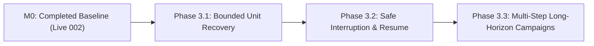

# TRIGLAV Technical Roadmap & Phase 3 Specification

> **Current Milestone Baseline:** `LIVE_002_INDEPENDENTLY_CONFIRMED` (15 October 2026) 
> **Immediate Focus:** GitHub Publication Readiness & Architectural Baseline 
> **Deferred Optional Work:** HotPin 120B optimization remains deferred and must never block the core loop.

---

## 1. Capability Status & Qualification Tiers

Before advancing to Phase 3 development, capabilities must be strictly categorized by their verified state:

### Tier 1: Implemented & Offline Validated
- **Native Windows Controller:** Python 3.11+ standard library controller (`harness.py`, `manager.py`, `work_unit_scheduler.py`).
- **Closed SafeQwen Protocol:** 3-tool contract (`read_files`, `edit_file`, `submit`) with exact hash-verified single replacements.
- **Supervisor Job Objects & Heartbeats:** Process identity tracking, fail-closed heartbeat validation, native process tree cleanup.
- **Durable Store / WAL:** Append-only ledger (`events.jsonl`), pre-write publication guard, 1-to-1 verifier WAL binding, cryptographic terminal seal.
- **Guarded Offline CI:** 390 reviewed offline test cases (`scripts/ci_offline.py`) passing with zero live model calls.

### Tier 2: Live Verified Capabilities
- **Single WorkUnit Terminal Acceptance (Live Run 001):** 1 coding unit, 10/10 frozen tests, real Qwen/Nemotron/GPT-OSS inference, 136 WAL records, verified terminal seal.
- **Two Dependent WorkUnits (Live Run 002):** 2 dependent coding units (`multiply` -> `scale`), 15/15 frozen tests, real three-model inference, 213 WAL records, verified terminal seal, independently confirmed by Codex.

### Tier 3: Implemented but NOT Live Qualified
- **Interrupted Recovery & Resume:** Store reload and resume logic are implemented and tested offline, but have **not** been qualified during live model inference.
- **Bounded Error Recovery:** Replanning after a failed worker attempt exists in offline test harnesses, but has **not** been qualified in live multi-turn model interaction.
- **Live TTL Reload:** Dynamic model reloading and Gateway restart mid-campaign remain unverified in live runs.

---

## 2. Phase 3 Technical Milestones

Phase 3 addresses long-horizon autonomous resilience. **None of Phase 3 is qualified by Live 002.**

### Milestone 3.1 — Controlled Bounded Recovery after a Failed WorkUnit
- **Objective:** Enable the harness to recover gracefully when a WorkUnit's deterministic verification fails.
- **Mechanisms:**
  - Diagnostic error capture without exposing unreviewed test implementations to the model.
  - Bounded retry budget per WorkUnit (maximum 2 retries).
  - Rollback to the last trusted intermediate checkpoint if retries are exhausted.
  - Prevention of false-trust promotion: failed attempts must leave immutable negative evidence in the WAL.
- **Acceptance Criterion:** A live coding task where Unit 1 initially introduces an intentional defect, the deterministic verifier rejects it, the executor receives bounded failure diagnostics, repairs the defect, and passes deterministic verification without manual intervention.

### Milestone 3.2 — Safe Interruption and Reliable Resume
- **Objective:** Allow an operator or external signal (SIGINT / process termination) to safely pause a running multi-unit campaign and resume without evidence corruption or duplicate model invocations.
- **Mechanisms:**
  - Atomic interruption boundary: cleanly abort in-flight requests or wait for the active tool step to settle.
  - Flushed WAL checkpoint prior to supervisor shutdown.
  - Resume probe: upon restart, verify repository snapshot, model availability, and WAL consistency before resuming at the exact pending WorkUnit.
- **Acceptance Criterion:** A live two-unit run interrupted during Unit 2 inference resumes cleanly, re-uses Unit 1's validated checkpoint, completes Unit 2, and commits terminal acceptance with a contiguous WAL.

### Milestone 3.3 — Sustained Multi-Step Long-Horizon Operation
- **Objective:** Scaling beyond 2 WorkUnits to 5+ sequential units with branch dependencies and cumulative regression suites.

---

## 3. Documentation Backlog & Reference Comparisons

The following architectural references and investigations are maintained in the documentation backlog:

| Reference / Investigation | Focus Area | Status |
|---|---|---|
| **AMAP-ML/LongHorizon-Harness** | Comparative analysis of plan-execute-verify-recover state loops and milestone persistence. | Backlog (conceptual inspiration retained; no code import) |
| **Utopia Architecture** | Study of deterministic isolation boundaries and transaction rollbacks in autonomous agent workflows. | Backlog |
| **Manager Report Reconciliation** | Aligning legacy `final-report.json` criterion projection (`NOT_PROVEN`) with Store WAL terminal acceptance without compromising WAL immutability. | Backlog (P3 maintenance) |
| **Smaller Reviewer Evaluation** | Evaluating compact quantized models (e.g., 30B class) for senior reviewer arbitration against frozen boundary test suites to reduce host memory requirements from 44 GiB. | Backlog (post-P3) |

---

[Architecture](../../ARCHITECTURE.md) · [Qualification](QUALIFICATION.md) · [Safety](SAFETY_AND_LIMITATIONS.md) · [Licensing](../../LICENSING.md).
